# CUDA Relativistic Hadron & Light-Cluster ($A \le 6$) Transport

[](#verification-suite)
[](#build--quickstart)
[](LICENSE)

> [!IMPORTANT]
> **Disclaimer:** This codebase is a **Gemini 4 Carbon** product (thanks Google!) and **requires independent testing and physics validation** before production or publication use. What it *does* demonstrate is that **hundreds-fold GPU speed-ups** over single-core CPU heavy-ion transport — scaling cleanly on a single consumer **12 GB RTX 3060** from **`394 × 1,000 = 394,000` test particles (`10.6 s`, `~208×` vs. equivalent `N_test = 80` single-core CPU ensemble runs / `28.2×` vs. a single-process $O(N_{\text{test}})$ CPU run)** to **`394 × 5,000 = 1.97M` particles (`28.7 s`, `~328×` / `31.2×`)** and all the way up to **`394 × 100,000 = 39.4M` test particles (`6.5 min` vs. `~52 hours` ensemble / `~4.4 hours` single-process on 1 CPU core, `~486×` / `~41×`)** with full Skyrme+MD potentials, 3D Poisson Coulomb, 6D Pauli blocking, $\Delta/\pi$ reactions, and $A \le 6$ Grand-Canonical HCGF freeze-out — are readily achievable.

## GPU vs. Single-Core CPU Performance Scaling (`RTX 3060 12 GB`, Native `FP32`)

220-step central $\text{Au}+\text{Au}$ @ $1.2\,A\;\text{GeV}$ ($68^3$ lattice, `SM` Skyrme + Momentum-Dependent mean field, 3D Poisson Coulomb, 6D Pauli blocking, $\Delta/\pi$ reactions, and $A \le 6$ Grand-Canonical HCGF freeze-out):

| $N_{\text{test}}$ / Baryon | Initial Test Baryons ($394 \times N_{\text{test}}$) | Freeze-Out $M_{\text{over}}$ | **RTX 3060 GPU (`FP32`)** | **1 CPU Core** (Equiv. $N_{\text{test}}=80$ Runs) | **Speed-Up** (vs. Ensemble) | **1 CPU Core** (Single-Process $O(N_{\text{test}})$) | **Speed-Up** (Same Process) |
| :---: | :---: | :---: | :---: | :---: | :---: | :---: | :---: |
| `80` | `31,520` | `1` (`10`) | **`4.58 s`** (`4.41 s`) | `150.6 s` (`176.7 s`) | **`32.9×` (`40.1×`)** | `150.6 s` (`176.7 s`) | **`32.9×` (`40.1×`)** |
| `1,000` | `394,000` | `10` (`1`) | **`10.62 s`** (`9.40 s`) | `~2,209 s` (`~1,883 s`) | **`~208×` (`~200×`)** | `299.9 s` (`266.2 s`) | **`28.2×` (`28.3×`)** |
| `5,000` | `1,970,000` | `1` (`2`) | **`28.68 s`** (`29.53 s`) | `~9,413 s` (`2.6 h`) | **`~328×`** | `896.1 s` (`14.9 min`) | **`31.2×`** |
| `10,000` | `3,940,000` | `1` | **`50.00 s`** | `~18,825 s` (`5.2 h`) | **`~377×`** | `~1,715 s` (`28.6 min`) | **`~34.3×`** |
| `20,000` | `7,880,000` | `1` | **`89.89 s`** | `~37,650 s` (`10.5 h`) | **`~419×`** | `~3,290 s` (`54.8 min`) | **`~36.6×`** |
| `50,000` | `19,700,000` | `1` | **`203.38 s`** (`3.4 min`) | `~94,125 s` (`26.1 h`) | **`~463×`** | `~8,015 s` (`2.2 h`) | **`~39.4×`** |
| `75,000` | `29,550,000` | `1` | **`291.14 s`** (`4.9 min`) | `~141,188 s` (`39.2 h`) | **`~485×`** | `~11,950 s` (`3.3 h`) | **`~41.0×`** |
| **`100,000`** | **`39,400,000`** | `1` | **`387.71 s`** (`6.5 min`) | `~188,250 s` (`52.3 h`) | **`~486×`** | `~15,890 s` (`4.4 h`) | **`~41.0×`** |

*Note: Single-core CPU baselines up to $N_{\text{test}} = 5{,}000$ were measured directly with `taskset -c 0` (`FP32` host build). In a single-process Bird/BAMPS `DisjointPairs` CPU run, the $68^3$ 3D Poisson/Skyrme grid cost (`~140.5 s`) is amortized once across all $N_{\text{test}}$ particles plus an out-of-L3-cache particle slope of `~0.158 s` per $N_{\text{test}}$; against standard $O(N_{\text{test}}^2)$ full-ensemble `AllPairs` BUU, the GPU speed-up exceeds $1{,}000\times$ above $N_{\text{test}} = 5{,}000$.*

---

A GPU-native relativistic Vlasov–Boltzmann (BUU) transport and Eckart-frame HCGF freeze-out code written in **CUDA C++17** for **58 hadronic and nuclear species ($A \le 6$)**: **protons, neutrons, pions ($\pi^-, \pi^0, \pi^+$), $\Delta(1232)$ resonances ($\Delta^-, \Delta^0, \Delta^+, \Delta^{++}$), bound light nuclei ($d, t, {}^3\text{He}, {}^4\text{He}, {}^6\text{He}, {}^6\text{Li}$), and 43 discrete TUNL excited/particle-unstable nuclear resonances** across $A=2$ ($nn^*, d^*, pp^*$), $A=4$ (${}^4\text{H}^*, {}^4\text{He}^*, {}^4\text{Li}^*$), $A=5$ (${}^5\text{H}, {}^5\text{He}, {}^5\text{Li}$), and $A=6$ (${}^6\text{H}, {}^6\text{He}^*, {}^6\text{Li}^*, {}^6\text{Be}$). Features **6D phase-space Pauli blocking $(1 - f_3)(1 - f_4)$ (`--pauli on`), Skyrme + Lorentzian momentum-dependent mean-field potentials (GBD / Danielewicz), heavy-ion collision initialization & FOPI flow observables ($v_1, v_2, dN/dy$), 24-field baryon-only Eckart-frame stress-energy tensor export (`HCGF`), interacting quantum Fermi/Bose INCG EoS inversion on downward $n_B < n_{\text{fr}}$ crossings, Pratt–Torrieri local momentum-anisotropy freeze-out ($p_i^* = \Lambda_{ij} q_j, \det\Lambda = 1$), off-shell Breit–Wigner spectral functions, multi-step sequential resonance cascade decays, $2 \leftrightarrow 1$ resonance formation/decay, 62 reversible $2 \leftrightarrow 2$ inelastic channels, and Glauber elastic scattering**.

When `nvcc` is present, all symplectic Vlasov CIC density/force kernels, 3D Gaussian smearing, dynamic slot compaction, multi-level prefix-sum cell sorting, counter-based Philox RNG, and stochastic reaction/decay kernels execute natively on the GPU. On machines without `nvcc` (such as macOS laptops or CI runners), CMake seamlessly compiles the exact same physics kernels via a zero-dependency C++17 host backend.

---

## Visual Demonstrations

### Full FOPI $\text{Au}+\text{Au}$ Excitation Benchmark ($0.09\text{–}1.50\,A\;\text{GeV}$, All 10 Energies: `SM` vs. `HM` vs. `Cascade`, Native `FP32`, $N_{\text{test}}=1000$ + $10\times$ Oversampling)
Complete 10-energy FOPI $\text{Au}+\text{Au}$ excitation-function benchmark (`90, 120, 150, 250, 400, 600, 800, 1000, 1200, 1500` $A\;\text{MeV}$, `scripts/run_fopi_all_energies_gc_oversample.py`, `300` total paired-seed BUU runs = `10` runs/energy/model [`5` central $b_0 < 0.15$ + `5` semi-central $0.25 < b_0 < 0.45$] comparing **`SM` (`md-soft`, $K_0 = 215\;\text{MeV}$)** vs. **`HM` (`md-stiff`, $K_0 = 380\;\text{MeV}$)** vs. **pure `Cascade` ($U = 0$, no nuclear or Coulomb potentials)** in native `FP32` at `N_test = 1000`, `--sampling gc --fo-oversample 10 --backflow remelt --pauli on --anisotropy on --max-cluster-A 6 --nfr 0.02`):

<p align="center">
  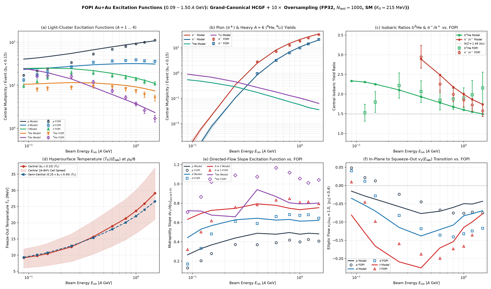
</p>

<details>
<summary><b>Per-Energy 6-Panel FOPI Comparisons (90 – 1500 A MeV)</b></summary>

<p align="center">
  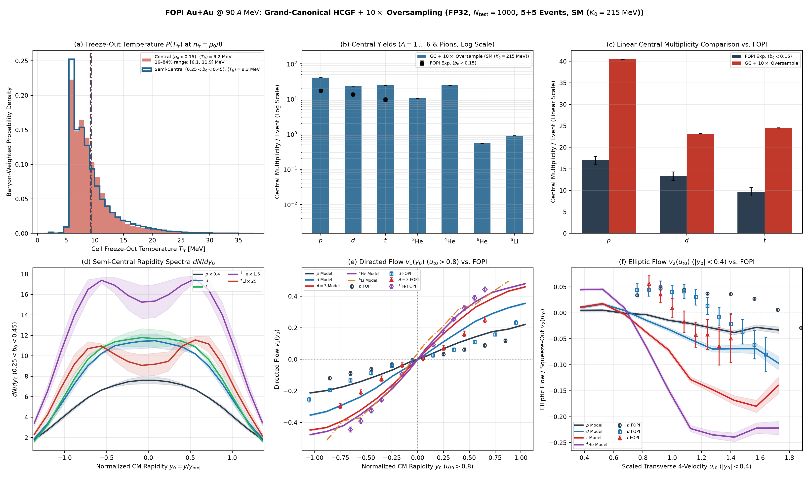
  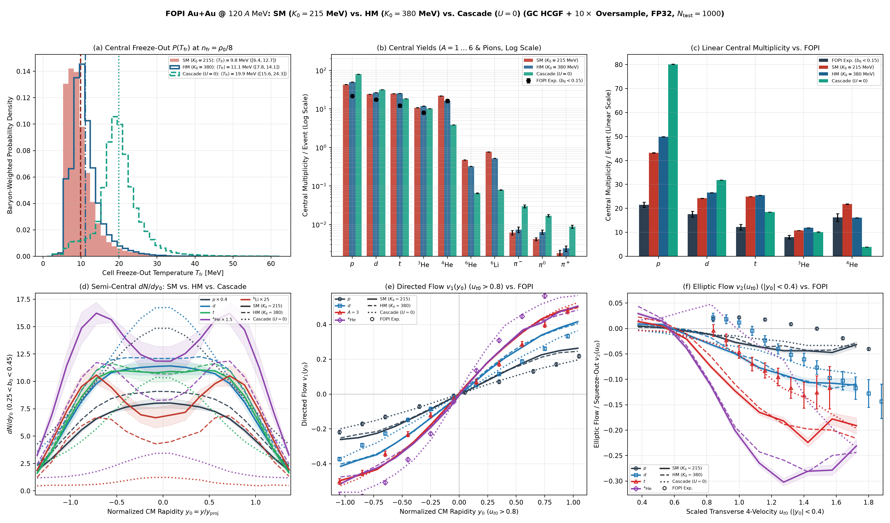
  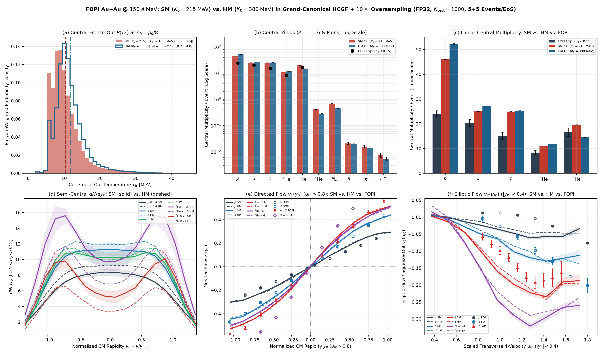
  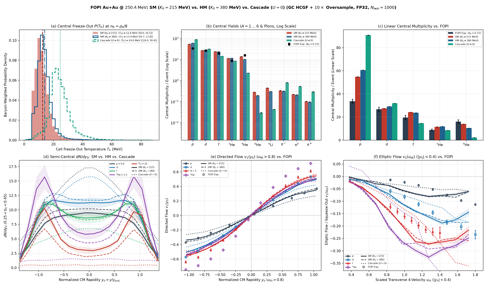
  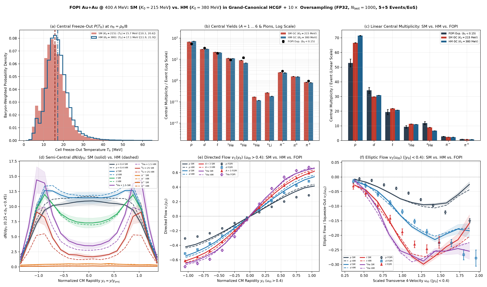
  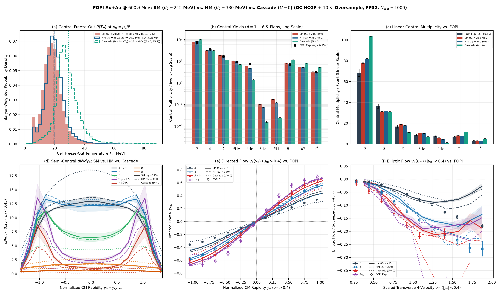
  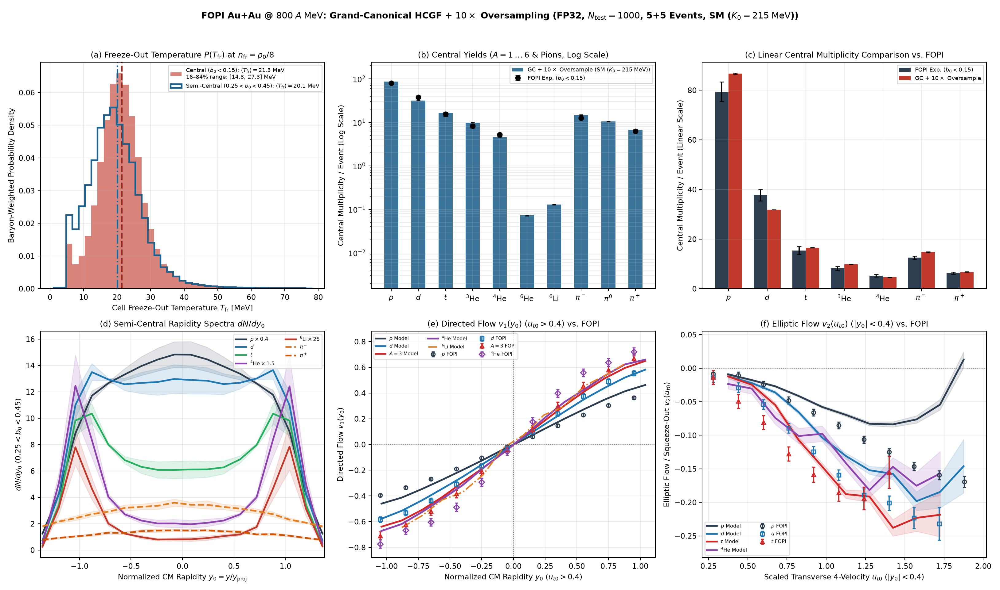
  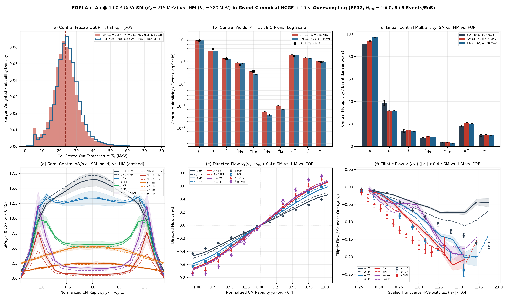
  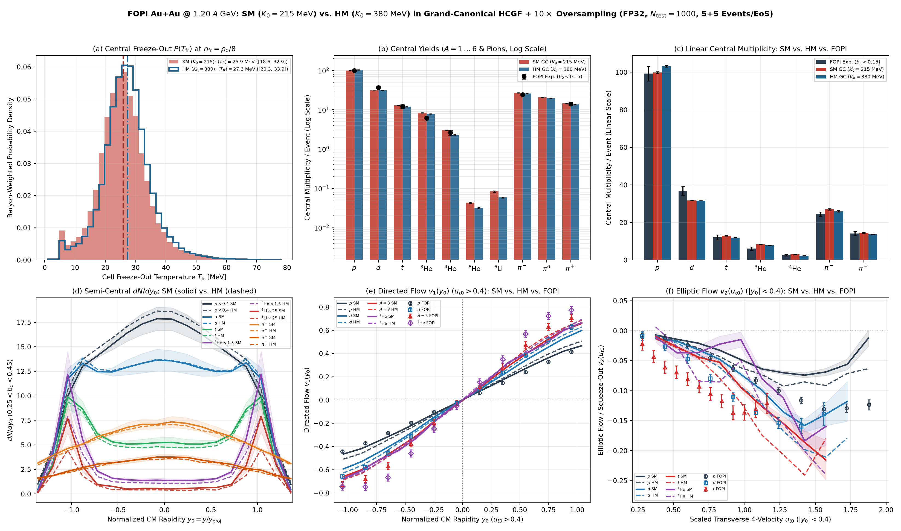
  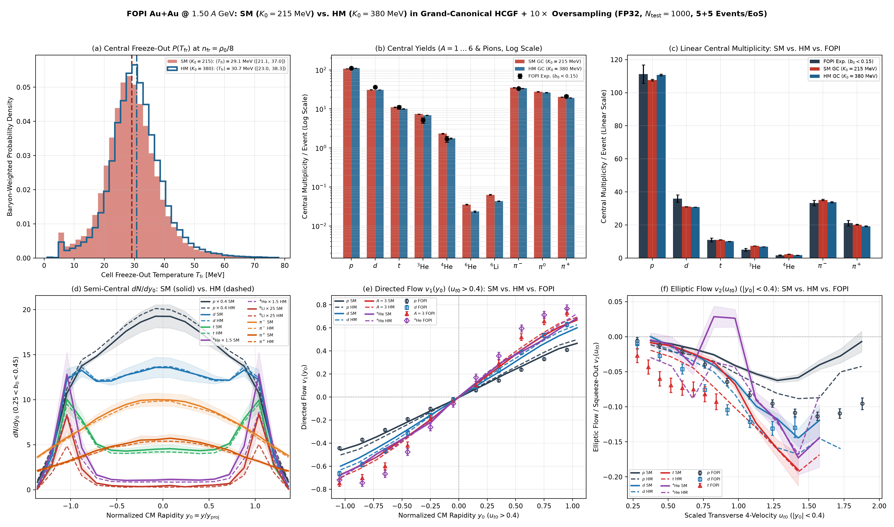
</p>
</details>

### 1. FOPI $\text{Au}+\text{Au}$ @ $1.2\,A\;\text{GeV}$: `SM` ($K_0 = 215\;\text{MeV}$) vs. `HM` ($K_0 = 380\;\text{MeV}$) Grand-Canonical HCGF + $\Delta(1232)/\pi$ Transport
High-statistics (`6,400` $\text{Au}+\text{Au}$ events, `scripts/run_auau1200_benchmark.py`, `--elab-amev 1200 --box 68 --grid 68 --sampling gc --coulomb on --pauli on`) benchmark across central ($b_0 < 0.15$) baryon/cluster + pion multiplicities ($p, d, t, {}^3\text{He}, {}^4\text{He}, \pi^-, \pi^+$) and semi-central ($0.25 < b_0 < 0.45$) directed flow $v_1(y_0)$ ($u_{t0} > 0.4$) and squeeze-out $v_2(u_{t0})$ ($|y_0| < 0.4$) against FOPI Collaboration data:

<p align="center">
  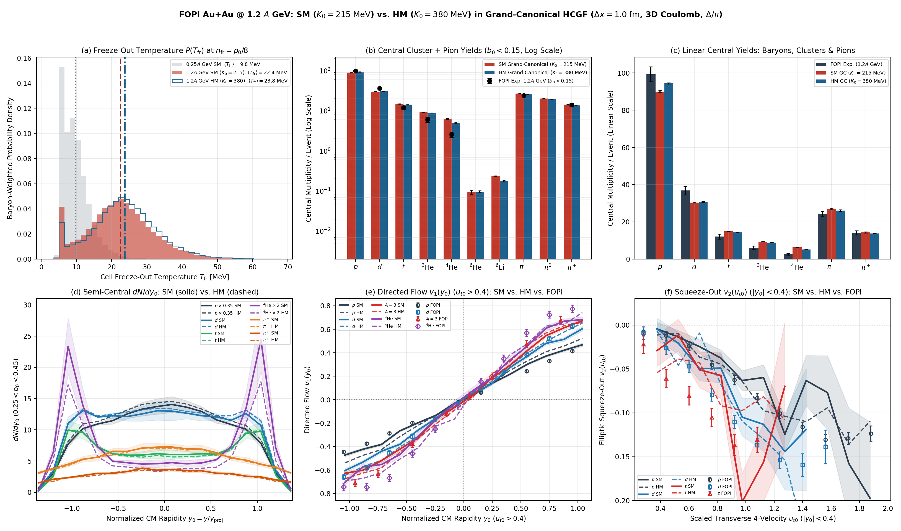
</p>

**1 Single BUU Run (`N_test = 80`) + $50\times$ Freeze-Out Oversampling (`--fo-oversample 50`, systematic backflow resampling to $N_{\text{test}}$ + Mott remelting)**: Adds only `+12%` runtime (`133s` vs. `119s`) while delivering `4,000` effective cluster events (`30,334` oversampled backflow copies thinned to `461` reabsorbed nucleons + `143` remelted clusters) and resolving smooth $A = 1 \dots 6$ flow including rare ${}^6\text{He}$ and ${}^6\text{Li}$:

<p align="center">
  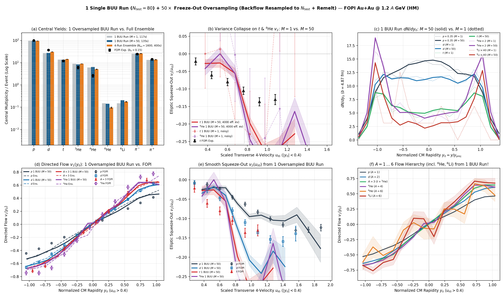
</p>

### 2. Grand-Canonical Poisson HCGF ($\Delta x = 1.0\;\text{fm}$) + 3D Coulomb + Exact $T^{00}$ Potential vs. FOPI $0.25\,A\;\text{GeV}$ Data
High-statistics FOPI $\text{Au}+\text{Au}$ @ $250\,A\;\text{MeV}$ benchmark (`scripts/run_gc_dx1fm_benchmark.py`, `--box 68 --grid 68 --sampling gc --coulomb on --pauli on`) showing how $\Delta x = 1.0\;\text{fm}$ coarse-graining removes sub-cell Hubble shear smearing (cooling $\langle T_{\text{fr}} \rangle$ from $14.3\;\text{MeV} \to 9.5\;\text{MeV}$) and how **Grand-Canonical Poisson particlization (`--sampling gc`)** brings $p, d, t, {}^3\text{He}$ yields, $v_1(y_0)$, and squeeze-out $v_2(u_{t0})$ into close agreement with published FOPI data:

<p align="center">
  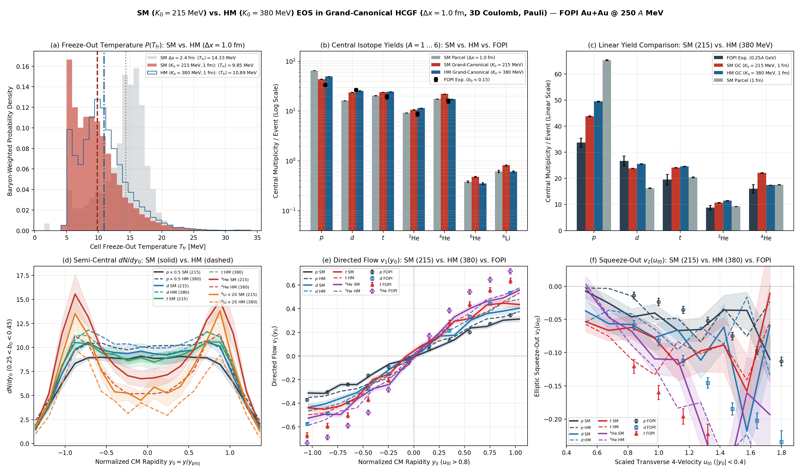
</p>

### 2. 6D Phase-Space Pauli Blocking $(1 - f_3)(1 - f_4)$ + Downward $n_{\text{fr}} = \rho_0 / 8$ Crossing + Interacting Quantum INCG HCGF
High-statistics (`16,000` $\text{Au}+\text{Au}$ events, `scripts/run_pauli_hcgf_benchmark.py`) FOPI $\text{Au}+\text{Au}$ @ $250\,A\;\text{MeV}$ benchmark showing how 6D phase-space Pauli blocking, downward post-compression freeze-out crossing ($dn_B/dt \le 0$), and matching the interacting Eckart energy $e_{\text{tr}} = e_{\text{kin}}^* + V_{\text{pot}}/n_B$ to the quantum Fermi–Dirac / Bose–Einstein INCG EoS cool $\langle T_{\text{fr}} \rangle$ from $22.1\;\text{MeV} \to 14.5\;\text{MeV}$ and boost heavy clusters (${}^4\text{He}, {}^6\text{He}, {}^6\text{Li}$, $t$, ${}^3\text{He}$):

<p align="center">
  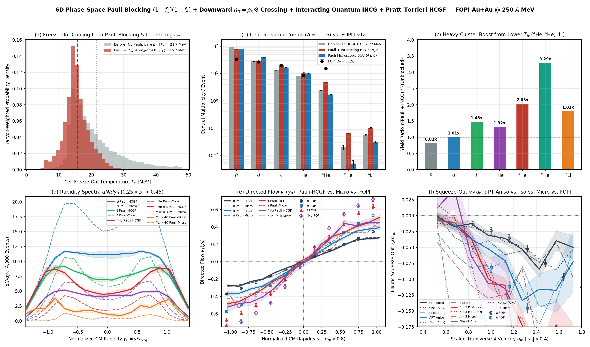
</p>

### 2. Extended $A = 4, 5, 6$ Isotope & TUNL Resonance Catalog (58 Species, Multi-Step Cascade Feed-Down)
High-statistics FOPI $\text{Au}+\text{Au}$ @ $250\,A\;\text{MeV}$ benchmark (`scripts/run_a456_isotope_benchmark.py`, `--max-cluster-A 6`) comparing **58-species $A \le 6$ Eckart-frame freeze-out** ($n_{\text{fr}} = \rho_0 / 8$) and **microscopic BUU** against $A \le 4$ baselines and FOPI Collaboration data, resolving bound ${}^6\text{He}, {}^6\text{Li}$ production alongside sequential cascade feed-down from ${}^5\text{He}, {}^5\text{Li}, {}^6\text{He}^*, {}^6\text{Li}^*, {}^6\text{Be}^*$ into ${}^4\text{He}$, $t$, and ${}^3\text{He}$:

<p align="center">
  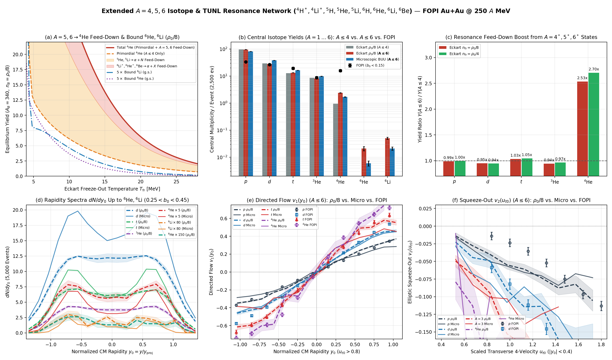
</p>

### 2. HCGF Pratt–Torrieri Local Momentum Anisotropy ($p_i^* = \Lambda_{ij} q_j,\; \det\Lambda = 1$) vs. Isotropic Freeze-Out
Paired-seed FOPI $\text{Au}+\text{Au}$ @ $250\,A\;\text{MeV}$ benchmark (`scripts/run_hcgf_anisotropy_benchmark.py`, `--anisotropy on` vs. `off`) matching the full $3 \times 3$ Eckart rest-frame pressure tensor $P_{ij}^* = L^i_{\;\mu} L^j_{\;\nu} T_B^{\mu\nu}$ via a volume-preserving ($\det\Lambda = 1$) Pratt–Torrieri transformation while keeping $(T_{\text{fr}}, \mu_B, \mu_Q)$ and chemical yields strictly invariant:

<p align="center">
  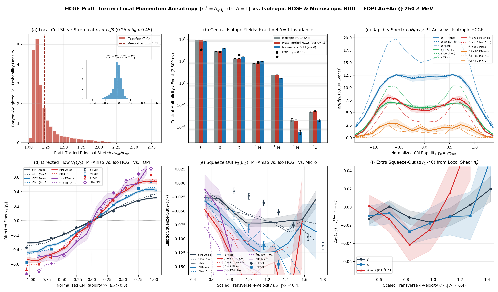
</p>

### 3. Microscopic Dynamical Clusters vs. Baryon-Only Eckart-Frame ($u^0 E - \vec{P}\cdot\vec{u}$) HCGF Freeze-Out ($n_B < n_{\text{fr}} = \rho_0 / 8$)
High-statistics (`27,500` $\text{Au}+\text{Au}$ events = $10.84\;\text{M}$ test nucleons, `scripts/run_highstat_rho0_over_8.py`) side-by-side benchmark in FOPI $\text{Au}+\text{Au}$ @ $250\,A\;\text{MeV}$ (`MD-Soft`) between **full microscopic dynamical cluster transport** (`--cluster-mode microscopic`) and **pure hadronic ($N + \Delta + \pi$) transport** with baryon-only **Eckart-frame** 24-field `HCGF` stress-energy tensor $T_B^{\mu\nu}$ export (`--dump-tmunu-dir`), cell rest-frame energy $E_{\text{rest}} = u^0 E - \vec{P}\cdot\vec{u}$ EoS inversion, and conservative Mott re-melting of back-emitted particles at $n_{\text{fr}} = \rho_0 / 8 = 0.020\;\text{fm}^{-3}$ (`--cluster-mode freezeout --backflow remelt --nfr 0.02`):

<p align="center">
  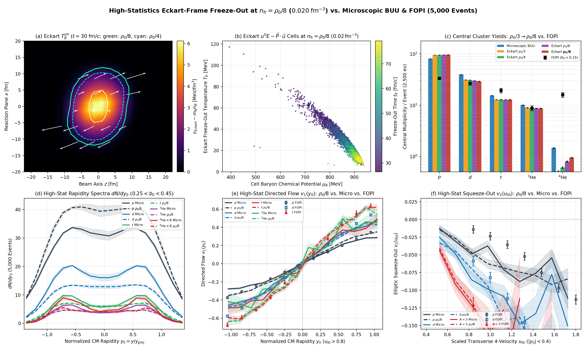
</p>

<p align="center">
  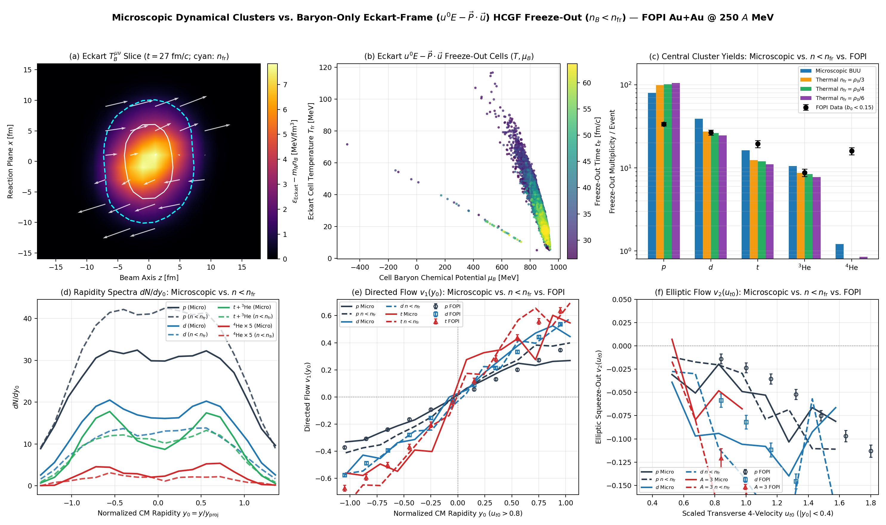
</p>

### 2. FOPI Heavy-Ion Benchmark: $\text{Au} + \text{Au}$ @ $250\,A\;\text{MeV}$ (`--mode hic`, `--dump-hydro-dir`)
Semi-central ${}^{197}\text{Au} + {}^{197}\text{Au}$ collision at $E_{\text{lab}} = 250\,A\;\text{MeV}$ ($b = 5.5\;\text{fm}$, equal-velocity CM rapidity $y_{\text{beam}} = \pm 0.3572$, `MD-Soft` Skyrme + Lorentzian momentum-dependent potential). Two Woods–Saxon + local Thomas–Fermi nuclei compress to $\max(n_B / \rho_0) \approx 1.80$ with local excitation energy density $\varepsilon_{\text{LRF}} - m_N n_B \approx 60\;\text{MeV}/\text{fm}^3$, exhibiting in-plane spectator bounce-off ($v_1$), midrapidity out-of-plane squeeze-out ($v_2 < 0$), and abundant light-cluster production ($d, t, {}^3\text{He}, {}^4\text{He}$):

<p align="center">
  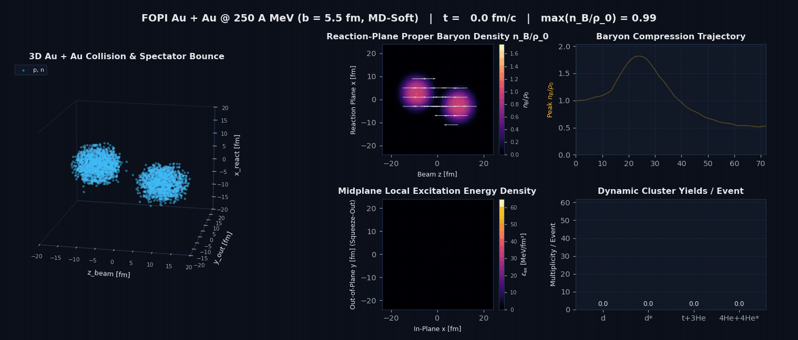
</p>

Direct benchmark against published **FOPI Collaboration experimental data** (W. Reisdorf *et al.*, *Nucl. Phys. A* **848** (2010) 366 & *Nucl. Phys. A* **876** (2012) 1) comparing `MD-Soft` ($K_0 = 215\;\text{MeV}$) vs. `MD-Stiff` ($K_0 = 380\;\text{MeV}$) under identical FOPI centrality ($0.25 < b_0 < 0.45$ and $b_0 < 0.15$) and scaled transverse 4-velocity ($u_{t0} > 0.8$) cuts:

<p align="center">
  
</p>

<p align="center">
  
</p>

### 2. Pion ($\pi^-, \pi^0, \pi^+$) & $\Delta(1232)$ Isobar Transport (`scripts/generate_pion_delta_physics.py`)
Coupled $\Delta(1232)$ $p$-wave Breit–Wigner spectral transport ($m_0 = 1.232\;\text{GeV}, \Gamma_0 = 118\;\text{MeV}$), resonant $\pi N \leftrightarrow \Delta$ ($\sigma_{\pi^+ p \to \Delta^{++}} = 193\;\text{mb}$, $3:1$ Clebsch–Gordan ratio to $\pi^- p \to \Delta^0$), isospin-$I=1$ $NN \leftrightarrow N\Delta$ and $NN \leftrightarrow d\pi$ reactions, and $\text{Au}+\text{Au}$ pion excitation functions ($0.25\text{–}1.2\,A\;\text{GeV}$), $\pi^-/\pi^+$ ratios, rapidity spectra, and flow vs. FOPI data:

<p align="center">
  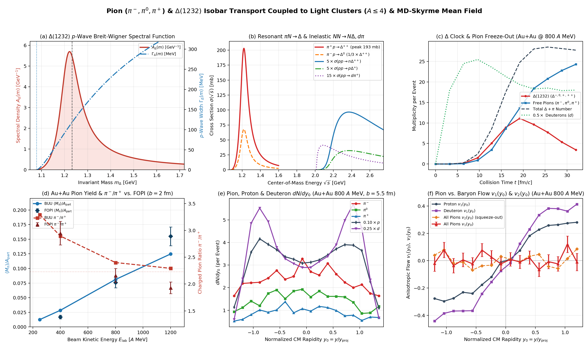
</p>

### 3. `FP64` (`double`) vs. `FP32` (`float`) Precision Benchmark (`cluster_transport` vs. `cluster_transport_fp32`)
CMake builds both `cluster_transport` (`double`, 64-bit) and `cluster_transport_fp32` (`float`, 32-bit, `-DTRANSPORT_SINGLE_PRECISION=1`, unlocking $12.7\;\text{TFLOPS}$ FP32 pipes & hardware FP32 L2 atomics on consumer GeForce GPUs). Because `kinematics.cuh` uses the cancellation-free identity $Q^2 = |E_2\vec{p}_1 - E_1\vec{p}_2|^2 - |\vec{p}_1 \times \vec{p}_2|^2$, `FP32` avoids catastrophic near-threshold failure for boosted $A=4$ clusters and reproduces `FP64` FOPI $dN/dy_0$, $v_1(y_0)$, $v_2(u_{t0})$, and cluster yields within statistical precision:

<p align="center">
  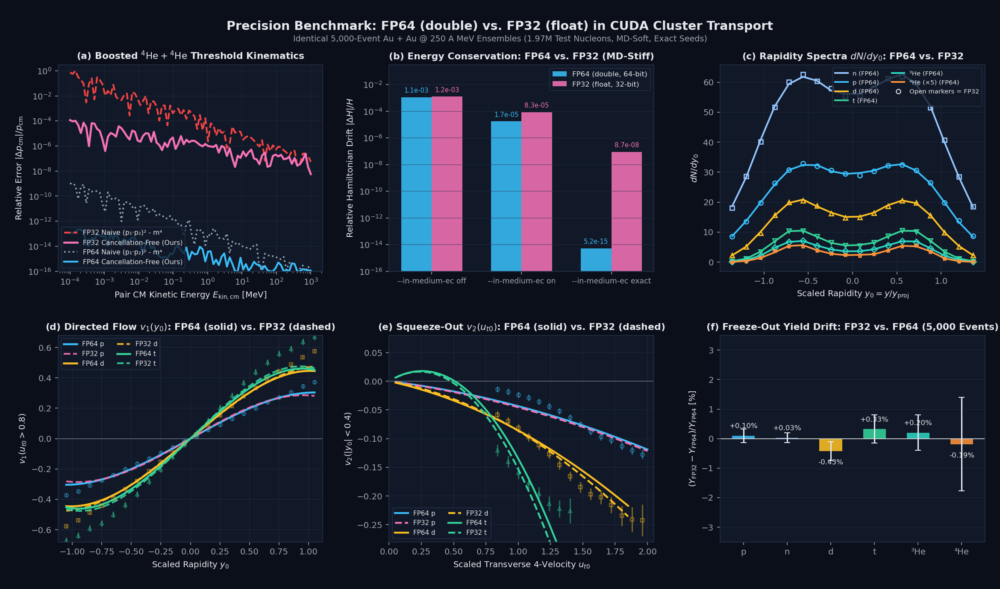
</p>

### 2. Spinodal Liquid–Gas Phase Separation & Cluster Droplets (`--eos md-soft` vs `--eos none`)
Inside the sub-saturation nuclear spinodal zone ($\rho_B \approx 0.27\,\rho_0$, $T_0 = 6\;\text{MeV}$), a free cascade stays spatially uniform whereas the **Skyrme + Lorentzian Momentum-Dependent mean field** ($K_0 = 215\;\text{MeV}$, $m^*(p_F)/m = 0.69$) spontaneously amplifies Poisson density fluctuations into self-bound liquid nuclear droplets enriched with $d, t, {}^3\text{He}, {}^4\text{He}$, and ${}^4\text{He}^*$:

<p align="center">
  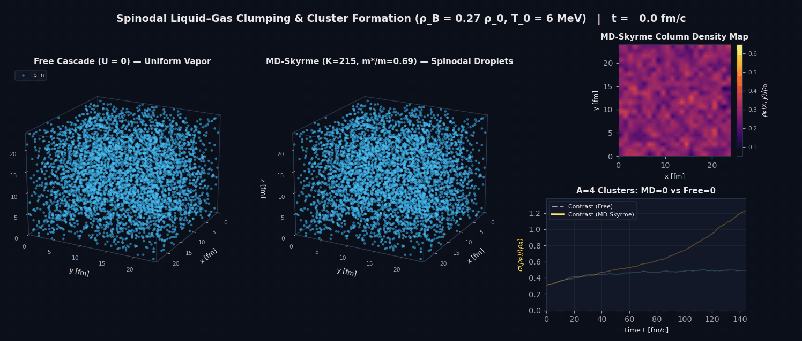
</p>

### 2. Nuclear Matter EOS & Momentum-Dependent Optical Potential (`--dump-eos`)
Exact saturation ($\rho_0 = 0.16\;\text{fm}^{-3}$, $E/A = -16.0\;\text{MeV}$, $P(\rho_0)=0$) across `Skyrme-Soft` ($K_0=200$), `MD-Soft` ($K_0=215$), and `MD-Stiff` ($K_0=380\;\text{MeV}$), alongside the single-nucleon optical potential $U_N(\rho_0, p)$ ($U(0) = -72.2\;\text{MeV}$, crossing zero at $p \approx 0.78\;\text{GeV}/c$ / $T_{\text{kin}} \approx 285\;\text{MeV}$):

<p align="center">
  
</p>

### 3. Sub-Saturation Cluster Nucleation at $\rho_B = n_0 / 8$, $T_{\text{start}} = 20\;\text{MeV}$
Starting from **100% pure protons and neutrons** at nuclear sub-saturation density $\rho_B = n_0 / 8 = 0.02\;\text{fm}^{-3}$ ($L = 30\;\text{fm}, N_{\text{test}} = 60$, zero probability overflows) and $T_{\text{start}} = 20.0\;\text{MeV}$, nearly **45% of all baryons** assemble into bound and resonant clusters ($d, d^*, t, {}^3\text{He}, {}^4\text{He}, {}^4\text{He}^*$)—exhibiting a BBN-like transient deuteron overshoot before converging onto the dashed analytical Saha / SHM equilibrium targets while self-heating the isolated box via cluster formation:

<p align="center">
  
</p>

### 2. High-Density Nucleosynthesis & Off-Shell Breit–Wigner Spectrum (`--mode nucleosynthesis`)
Starting from **100% pure protons and neutrons ($N_{\text{clusters}}(0) = 0$)** in a dense periodic box ($T_0 = 62\;\text{MeV}$), the coupled $2 \leftrightarrow 1$ and $2 \leftrightarrow 2$ network synthesizes the $A \le 4$ hierarchy while populating the thermal-folded Breit–Wigner spectral distribution:

<p align="center">
  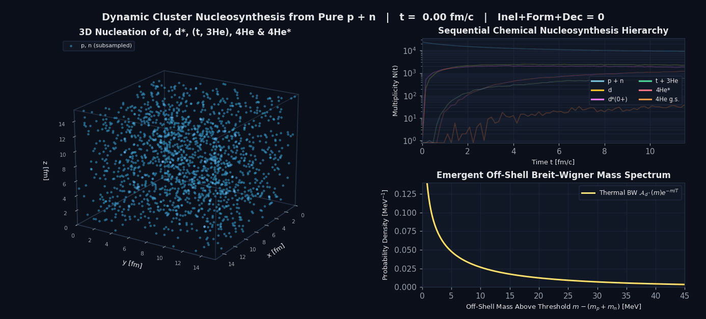
</p>

### 2. Relativistic Breit–Wigner Spectral Functions & Threshold Widths (`--dump-bw`)
Unit-normalized spectral functions $\mathcal{A}_R(m)$ and Blatt–Weisskopf momentum-dependent widths $\Gamma_{\text{tot}}(m) \propto q^{2L+1}$ across $s$-, $p$-, and $d$-wave resonances (`include/physics/resonances.cuh`):

<p align="center">
  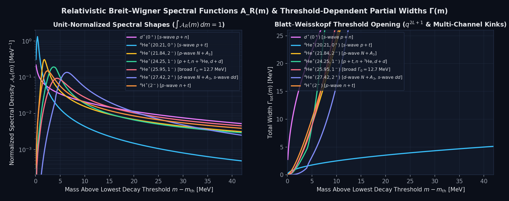
</p>

### 3. Counter-Streaming Nuclear & Excited-Cluster Slabs (`--mode slabs`)
Two opposing beams ($\beta_z = \pm 0.48c$) composed of nucleons ($p, n$), ground-state clusters ($d, t, {}^3\text{He}, {}^4\text{He}$), singlet dinucleons ($d^*$), and excited ${}^4\text{He}^*$ states collide head-on inside a 3D box. Bright yellow-white flashes mark active $2 \to 2$ elastic collision vertices in each step as longitudinal beam momentum splashes into transverse $4\pi$ thermal motion:

<p align="center">
  
</p>

### 2. 3D Expanding Heavy-Ion Hadronic & Cluster Fireball (`--mode fireball`)
A hot baryon-rich fireball ($R_{\text{rms}}(0) = 5\;\text{fm}$) initialized with radial Hubble flow and Maxwell–Jüttner local thermal motion expands into open vacuum, undergoing intense core elastic rescattering followed by kinetic freeze-out:

<p align="center">
  
</p>

### 3. Relativistic Boltzmann Pressure Isotropization (`--mode aniso`)
In a 3D periodic torus $[0, L)^3$, an initially momentum-anisotropic multi-species plasma ($P_z / P_\perp > 3$) relaxes exponentially to the isotropic Maxwell–Jüttner equilibrium circle while conserving total $P^\mu = (E, \vec{P})$ to IEEE-754 double precision ($|\Delta E|/E \sim 10^{-15}$) and $\Delta B = \Delta Q = 0$:

<p align="center">
  
</p>

---

## Physics Model

### Complete 58-Species Catalog (Hadrons + $A \le 6$ Bound & TUNL Excited Isotopes)
Defined in [`include/physics/species.cuh`](include/physics/species.cuh):

| Family | Species | $A$ | $Z$ | $J^\pi$ | $I$ | Notes |
| :--- | :--- | :---: | :---: | :---: | :---: | :--- |
| **Nucleons** | $p,\; n$ | 1 | 1, 0 | $1/2^+$ | $1/2$ | AME2020 / CODATA masses |
| **Pions & $\Delta(1232)$** | $\pi^{-,0,+},\; \Delta^{-,0,+,++}$ | 0, 1 | $-1..+2$ | $0^-,\; 3/2^+$ | $1,\; 3/2$ | $p$-wave Breit–Wigner $\Delta(1232)$ quartet ($\Gamma_0 = 118\;\text{MeV}$) |
| **Dinucleons ($A=2$)** | $d,\; nn^*(0^+),\; d^*(0^+),\; pp^*(0^+)$ | 2 | 0, 1, 2 | $1^+,\; 0^+$ | $0,\; 1$ | Bound deuteron + spin-singlet virtual/resonant $I=1$ triplet |
| **Trinucleons ($A=3$)** | $t,\; {}^3\text{He}$ | 3 | 1, 2 | $1/2^+$ | $1/2$ | Bound $A=3$ mirror doublet |
| **Alpha & ${}^4\text{He}^*$** | ${}^4\text{He}$ + 17 discrete TUNL levels | 4 | 2 | $0^\pm, 1^\pm, 2^\pm$ | $0, 1$ | Compact g.s. + $E_x = 20.21\;\text{MeV}$ ($0^+$) to $29.89\;\text{MeV}$ ($2^+$) |
| **Isobaric $A=4^*$** | 4 ${}^4\text{H}^*$ + 4 ${}^4\text{Li}^*$ levels | 4 | 1, 3 | $2^-, 1^-, 0^-$ | $1$ | Complete low-lying TUNL $p$-wave spin-orbit quartets ($t+n$, ${}^3\text{He}+p$) |
| **Unbound $A=5$** | ${}^5\text{H}(1/2^+)$, 3 ${}^5\text{He}^*$, 3 ${}^5\text{Li}^*$ | 5 | 1, 2, 3 | $1/2^\pm, 3/2^\pm$ | $3/2, 1/2$ | Includes $p_{3/2}, p_{1/2}$ $\alpha+N$ resonances & $3/2^+$ $d+t / d+{}^3\text{He}$ fusion peaks |
| **Bound $A=6$** | ${}^6\text{He}(0^+),\; {}^6\text{Li}(1^+)$ | 6 | 2, 3 | $0^+,\; 1^+$ | $1,\; 0$ | Borromean halo ${}^6\text{He}$ ($B=29.27\;\text{MeV}$) & stable ${}^6\text{Li}$ ($B=31.99\;\text{MeV}$) |
| **Resonant $A=6^*$** | ${}^6\text{H}(2^-),\; {}^6\text{He}^*(2^+)$, 4 ${}^6\text{Li}^*$, 2 ${}^6\text{Be}^*$ | 6 | 1..4 | $0^+, 1^+, 2^\pm, 3^+$ | $0, 1, 2$ | Multi-step sequential decays (${}^6\text{Be}\to p+{}^5\text{Li}\to 2p+\alpha$, ${}^6\text{Li}^*\to d+\alpha$) |

### Cancellation-Free Relativistic Kinematics
In [`include/physics/kinematics.cuh`](include/physics/kinematics.cuh), invariant pair quantities are evaluated via the algebraic identity

$$Q^2 \equiv (p_1 \cdot p_2)^2 - m_1^2 m_2^2 = |E_2 \vec{p}_1 - E_1 \vec{p}_2|^2 - |\vec{p}_1 \times \vec{p}_2|^2$$

eliminating catastrophic floating-point cancellation near threshold $s \to (m_1 + m_2)^2$ even when $\sim 3.75\;\text{GeV}$ excited $A=4$ clusters collide at keV relative kinetic energies under large Lorentz boosts.

### Elastic Cross Sections & Excited-State Spatial Swelling
Implemented in [`include/physics/cross_sections.cuh`](include/physics/cross_sections.cuh):
- **Elementary $NN$ ($pp, nn, np$)**: Smoothly bridges low-energy $S$-wave Effective Range Expansion (ERE), nuclear-regime Kikuchi–Kawai / Metropolis parameterizations, and high-energy Cugnon / PDG elastic fits.
- **Nucleon–Cluster & Cluster–Cluster**: Evaluates isospin-weighted $\bar{\sigma}_{NN}(\gamma_{\text{rel}})$ at the Lorentz-invariant relative factor $\gamma_{\text{rel}} = (p_1 \cdot p_2)/(m_1 m_2)$ and combines matter radii via the analytic Gaussian Glauber / Karol optical eikonal overlap:

$$\sigma_{AB}^{\text{el}}(\gamma_{\text{rel}}) = \pi a_{AB}^2 \ln\!\left(1 + \frac{A B \, \bar{\sigma}_{NN}(\gamma_{\text{rel}})}{\pi a_{AB}^2}\right), \qquad a_{AB}^2 = \frac{2}{3}\left(R_A^2 + R_B^2\right)$$

Diffuse excited states such as $d^*(0^+)$ and the ${}^4\text{He}^*(20.21, 0^+)$ monopole breathing mode naturally exhibit enhanced elastic cross sections relative to their compact ground states:

<p align="center">
  
</p>

---

## GPU Architecture & Repository Layout

```text
├── CMakeLists.txt                  # Auto-detects CUDA nvcc (SM 70–90) or C++17 host fallback
├── include/
│   ├── backend/
│   │   ├── cuda_compat.cuh         # DeviceBuffer<T>, atomic wrappers, CUDA/CPU portability macros
│   │   └── philox_rng.cuh          # Stateless counter-based Philox4x32-10 PRNG (zero VRAM state)
│   ├── physics/
│   │   ├── constants.cuh           # Physical constants, nucleon, pion, Delta & AME2020 A<=6 masses
│   │   ├── species.cuh             # 58-species hadron + A<=6 bound & TUNL resonance catalog
│   │   ├── kinematics.cuh          # Cancellation-free Moller flux, CM boosts, 2->2 & 1->2 decays
│   │   ├── cross_sections.cuh      # ERE+KK+Cugnon NN, pi-hadron & Gaussian Glauber cross sections
│   │   ├── resonances.cuh          # Core-refined Breit-Wigner spectral functions & BW samplers
│   │   ├── inelastic_channels.cuh  # 62 reversible 2<->2 NN<->NDelta, dpi, A<=6 transfer & excitation
│   │   └── mean_field.cuh          # Skyrme + Lorentzian MD potential, CIC Vlasov & smoothing
│   └── sim/
│       ├── particles.cuh           # Dynamic SoA layout with GPU atomic appends & compaction
│       ├── grid.cuh                # GPU multi-level prefix sum + counting-sort 3D cell builder
│       ├── stepper.cuh             # Symplectic Strang-split Vlasov + decay + stochastic collisions
│       ├── init_conditions.cuh     # Woods-Saxon + Thomas-Fermi HIC, grand-canonical & fireball
│       ├── hydro_io.cuh            # Binary 3D local energy & baryon density grid writer ("CHYD")
│       ├── hcgf_io.cuh             # 24-field baryon Eckart HCGF T_B^munu + J_B^mu + J_Q^mu exporter
│       ├── freezeout_clusters.cuh  # Eckart cell n_B < n_fr A<=6 clusterizer & Mott backflow remelter
│       ├── flow_observables.cuh    # Multi-step resonance cascade decay & FOPI A<=6 flow calculator
│       └── observables.cuh         # Parallel GPU reductions for P^mu, B, Q, T^ij & mass moments
├── src/
│   ├── main.cu                     # CLI simulation driver, CSV logger & binary HCGF/CHYD exporters
│   └── tests.cu                    # Automated 18-test physics, Vlasov, HCGF & A<=6 cascade suite
├── scripts/
│   ├── run_a456_isotope_benchmark.py
│   ├── run_highstat_rho0_over_8.py
│   ├── compare_microscopic_vs_hcgf_freezeout.py
│   ├── generate_pion_delta_physics.py
│   ├── generate_auau_fopi_plots.py # FOPI Au+Au 250 AMeV 3D+hydro animation & v1/v2/dNdy plots
│   ├── generate_meanfield_animations.py
│   ├── generate_inelastic_animations.py
│   └── generate_animations.py      # Reproduces all GIF/MP4 animations and physics figures
└── assets/                         # Rendered animations and spectral/cross-section plots
```

### Binary 3D Baryon Stress-Energy Tensor Format for HCGF (`HCGF`, Eckart Frame)
Passing `--dump-tmunu-dir <dir> --dump-tmunu-every <N>` writes self-describing binary 3D grid files `tmunu_grid_XXXX.bin` (`include/sim/hcgf_io.cuh`, coarse-grained strictly over **baryons $B > 0$**, excluding pions):
- **88-byte header (`HcgfTmunuHeader`)**: `uint32 magic = 0x46474348 ("HCGF")`, `int32 version=1, step, nx, ny, nz, n_fields=24, reserved`, `float64 t_fm, xmin, xmax, ymin, ymax, zmin, zmax`.
- **24 contiguous `float32` 3D arrays** of shape `(nz, ny, nx)`:
  - `[0..9]`: Symmetric baryon $T_B^{\mu\nu}$ (`T00 = T00_kin + V_pot`, exact conserved 3-momentum `T0x, T0y, T0z`, and kinetic stress `Txx..Tzz` in $\text{GeV}/\text{fm}^3$, so $\int T_B^{00} d^3x = H_B$ and $\int T_B^{0i} d^3x = P_B^i$ are both exact).
  - `[10..13]`: Baryon 4-current $J_B^\mu$ (`JB0, JBx, JBy, JBz` in $\text{fm}^{-3}$).
  - `[14..17]`: Baryonic electric charge 4-current $J_{Q,B}^\mu$ (`JQ0, JQx, JQy, JQz` in $\text{fm}^{-3}$).
  - `[18..23]`: Exact **Eckart rest-frame** fields ($u^\mu = J_B^\mu / n_B$: `eps_Eckart = u_mu T_B^munu u_nu, P_Eckart` in $\text{GeV}/\text{fm}^3$, `nB_Eckart` in $\text{fm}^{-3}$, `vx_E, vy_E, vz_E` in $c$).

### Binary 3D Local Energy & Baryon Density Format (`CHYD`)
Passing `--dump-hydro-dir <dir> --dump-hydro-every <N>` writes self-describing binary 3D grid files `hydro_grid_XXXX.bin` (`include/sim/hydro_io.cuh`):
- **88-byte header (`HydroGridHeader`)**: `uint32 magic = 0x44594843 ("CHYD")`, `int32 version, step, nx, ny, nz, n_fields=8, reserved`, `float64 t_fm, xmin, xmax, ymin, ymax, zmin, zmax`.
- **8 contiguous `float32` 3D arrays** of shape `(nz, ny, nx)`: `[0] rho_B_lab` ($\text{fm}^{-3}$), `[1] rho_B_lrf` (comoving proper $n_B = \sqrt{(J^0)^2 - |\vec{J}|^2}$), `[2] rho_Q_lab`, `[3] e_tot_lab` ($T^{00}_{\text{kin}} + \mathcal{V}_{\text{Skyrme+MD}}$ in $\text{GeV}/\text{fm}^3$), `[4] eps_lrf` (local rest-frame energy density $\varepsilon_{\text{LRF}}$ in $\text{GeV}/\text{fm}^3$), `[5..7] vx, vy, vz` ($c$).

### Stochastic Collision Kernel (`DisjointPairs` vs `AllPairs`)
Inside each spatial cell of volume $\Delta V$ containing $N_c$ test particles (oversampling factor $N_{\text{test}}$):
- **`DisjointPairs` (default, $O(N_p)$ lock-free GPU parallel)**: 1 CUDA thread block per cell performs an in-cache Fisher–Yates shuffle and evaluates all $M_c = \lfloor N_c / 2 \rfloor$ disjoint pairs $(2k, 2k+1)$ simultaneously across threads with exact odd/even pair-multiplicity weighting:
  $$P_{\text{pair}} = \frac{N_c(N_c - 1)/2}{\lfloor N_c / 2 \rfloor} \, \frac{v_{\text{Møller}} \, \sigma_{\text{el}}(\sqrt{s}) \, \Delta t}{N_{\text{test}} \, \Delta V}$$
- **`AllPairs`**: Traverses all $N_c(N_c-1)/2$ intra-cell pairs in randomized order with single-scatter-per-substep guards.

---

## Build & Quickstart

### 1. Build (CUDA GPU or CPU Host Fallback)
```bash
cmake -S . -B build -DCMAKE_BUILD_TYPE=Release
cmake --build build -j
```
On a CUDA workstation/cluster, CMake automatically invokes `nvcc` (pass `-DCMAKE_CUDA_ARCHITECTURES=native` to target your exact GPU).

### 2. Run Verification Suite (`ctest`)
```bash
ctest --test-dir build --output-on-failure -V
```

### 3. Run Simulations
```bash
# Print all 28 species (ground & excited), thresholds, spectral norms, and cross sections
./build/cluster_transport --print-species

# Dynamic nucleosynthesis of d, d*, t, 3He, 4He, and 4He* from pure p + n
./build/cluster_transport --mode nucleosynthesis --npart 30000 --ntest 15 --steps 80 --dt 0.15

# FOPI Au + Au @ 250 A MeV (b = 5.5 fm) with exact Hamiltonian conservation (--in-medium-ec <off|on|exact>)
./build/cluster_transport --mode hic --A-nuc 197 --Z-nuc 79 --elab-amev 250.0 --impact-b 5.5 \
  --eos md-soft --in-medium-ec exact --ntest 120 --box 48.0 --grid 24 --steps 240 --dt 0.30 \
  --dump-hydro-dir output/auau250_hydro --dump-hydro-every 5 --flow-csv output/fopi_auau250_flow.csv

# Spinodal clumping + cluster nucleation with MD-Soft Skyrme + Momentum-Dependent potential
./build/cluster_transport --mode nucleosynthesis --eos md-soft --npart 30000 --ntest 30 --temp 8.0 --steps 250 --dt 0.40

# Compare Soft (K0 = 215 MeV) vs Stiff (K0 = 380 MeV) MD-Skyrme in expanding fireball
./build/cluster_transport --mode fireball --eos md-stiff --reactions all --npart 100000 --ntest 25 --steps 80 --dt 0.25
```

### 4. Regenerate Animations & Figures
Requires `python3` (`numpy`, `matplotlib`) and `ffmpeg`:
```bash
python3 scripts/generate_auau_fopi_plots.py
python3 scripts/generate_meanfield_animations.py
python3 scripts/generate_n0_over_8_nucleation.py
python3 scripts/generate_inelastic_animations.py
python3 scripts/generate_animations.py
```

---

## Verification Suite

[`src/tests.cu`](src/tests.cu) validates all physics and numerical invariants on every build:
1. **`test_species_table`**: Quantum numbers ($B, Z, J^\pi, I, g=2J+1$), pole masses, widths, and radii across all 6 ground and 22 excited states.
2. **`test_relativistic_kinematics`**: Boosted sub-keV threshold elastic, exothermic $2 \to 2$ ($d+t \to n+{}^4\text{He}$), and $1 \to 2$ resonance decay kinematics conserving $P^\mu$ to $< 10^{-13}$.
3. **`test_cross_section_hierarchy`**: Verifies $\sigma_{pn} > \sigma_{pp}$, $\sigma_{p d^*} > \sigma_{p d}$, and $\sigma_{p\,{}^4\text{He}^*(20.21)} > \sigma_{p\,{}^4\text{He}}$.
4. **`test_breit_wigner_spectral_properties`**: Verifies unit spectral normalization $\int \mathcal{A}_R(m)\,dm = 1$, exact threshold vanishing $\Gamma(m \le m_{\text{th}}) = 0$, and $(B, Q)$ conservation across all 22 resonances and 46 inelastic $2 \leftrightarrow 2$ channels.
5. **`test_stochastic_boltzmann_rate`**: Benchmarks both `DisjointPairs` and `AllPairs` at odd cell occupancy ($N_c = 251$) against the exact analytical pair sum.
6. **`test_detailed_balance_2to1_resonances`**: Verifies microscopic $2 \leftrightarrow 1$ detailed balance ($p+n \leftrightarrow d^*$: formations match decays within $<1\%$) and stationary off-shell $\langle m_{d^*} \rangle$ in a grand-canonical box.
7. **`test_detailed_balance_full_chemical_network`**: Verifies chemical stationarity across all 28 species with all $2 \leftrightarrow 1$ and 46 $2 \leftrightarrow 2$ reactions simultaneously active.
8. **`test_dynamic_cluster_nucleosynthesis`**: Verifies spontaneous nucleation of $d, d^*, t, {}^3\text{He}, {}^4\text{He}$, and ${}^4\text{He}^*$ from pure $p+n$ with $|\Delta E|/E \sim 10^{-15}$.
9. **`test_reactive_expanding_fireball`**: Radial Hubble expansion with coupled elastic, inelastic, and resonance decay dynamics.
10. **`test_eos_saturation_and_md`**: Verifies exact cold-matter saturation ($E/A(\rho_0) = -16.00\;\text{MeV}$, $P(\rho_0)=0$, $K_0 = 200/215/380\;\text{MeV}$), optical-potential zero crossing ($U(0)=-72.2\;\text{MeV} \to U(1\;\text{GeV}/c)=+10.7\;\text{MeV}$), and Landau effective mass $m^*(p_F)/m = 0.692$.
11. **`test_vlasov_and_spinodal`**: Verifies symplectic Velocity-Verlet Hamiltonian conservation ($|\Delta H|/H \approx 1.0 \times 10^{-5}$ with $\nabla_{\vec{r}}\vec{p}_f$ product-rule force), exact CIC lattice momentum conservation ($|\Delta\vec{P}| \sim 10^{-13}\;\text{GeV}/c$), and spinodal density-contrast amplification.
12. **`test_hic_and_hydro_binary_output`**: Verifies Woods–Saxon + Thomas–Fermi $\text{Au}+\text{Au}$ CM initialization ($|\vec{P}_{\text{tot}}| < 10^{-11}\;\text{GeV}/c$) and binary `CHYD` 3D density grid conservation ($\int \rho_{B,\text{lab}}\,dV = 2 A_{\text{nuc}}$).
13. **`test_in_medium_collision_energy_conservation`**: Verifies `--in-medium-ec <off|on|exact>` across coupled $2\leftrightarrow 2$ and $2\leftrightarrow 1$ reactions under `MDStiff`, reducing $|\Delta H|/H$ from $1.93 \times 10^{-3}$ (`off`) $\to 2.32 \times 10^{-5}$ (`on`, per-vertex quasi-energy root solver) $\to 1.86 \times 10^{-14}$ (`exact`, + Hamiltonian manifold projection).
14. **`test_pion_delta_cross_sections_and_detailed_balance`**: Verifies PDG $\pi^+ p \to \Delta^{++}$ (`192.8 mb`) & $\pi^- p \to \Delta^0$ (`64.2 mb`) $3:1$ Clebsch–Gordan cross sections and grand-canonical $\pi\text{–}\Delta\text{–}N\text{–}d$ detailed balance with exact signed electric charge ($\Delta Q = 0$) conservation.
15. **`test_hic_pion_and_delta_production`**: Verifies dynamical $\Delta(1232)$ excitation, $\pi^-/\pi^+$ neutron-rich isospin asymmetry, and machine-precision Hamiltonian conservation (`|dH|/H = 1.24e-15`) in $\text{Au}+\text{Au}$ @ $800\,A\;\text{MeV}$.
16. **`test_hcgf_baryon_eckart_frame`**: Verifies 24-field baryon-only `HCGF` $T_B^{\mu\nu} + J_B^\mu + J_{Q,B}^\mu$ conservation (excluding injected counter-streaming pions) and exact relativistic Eckart 4-velocity $u^\mu = J_B^\mu / n_B$ recovery.
17. **`test_eckart_freezeout_and_remelt`**: Verifies cluster-free pure $N+\Delta+\pi$ transport (`--cluster-mode none`), Eckart $E_{\text{rest}} = u^0 E - \vec{P}\cdot\vec{u}$ local thermal clusterization (`--cluster-mode freezeout`), and conservative Mott re-melting (`25/25`) of back-emitted clusters re-entering dense $n_B > n_{\text{melt}}$ matter ($|\Delta E|/E < 10^{-13}$, $\Delta B = \Delta Q = 0$).
18. **`test_a456_isotopes_and_cascade_decays`**: Verifies all 58 species ($A \le 6$ isotopes ${}^4\text{H}, {}^4\text{He}, {}^4\text{Li}, {}^5\text{H}, {}^5\text{He}, {}^5\text{Li}, {}^6\text{H}, {}^6\text{He}, {}^6\text{Li}, {}^6\text{Be}$), core-refined spectral normalization down to $\Gamma = 24\;\text{keV}$ (`LI6_219`), multi-step cascade decays (`6H -> 5H+n -> t+3n`, `6Be* -> 5Li+p / 4He+pp* -> 4He+2p`, $|\Delta E|/E < 10^{-13}$), and $2.5\times$ $\alpha$ feed-down at $n_B = \rho_0 / 8$.
19. **`test_hcgf_pratt_torrieri_momentum_anisotropy`**: Verifies exact Lorentz projection of boosted $3\times 3$ shear stress tensors $P_{ij}^*$, exact volume preservation $\det\Lambda = 1$ (`1.000000`) and cluster multiplicity invariance, and transfer of local rest-frame squeeze-out anisotropy onto $A \ge 2$ clusters (`eps_cl: -0.057 -> +0.584`) with $|\Delta E|/E < 10^{-12}$.
20. **`test_pauli_blocking_and_interacting_hcgf`**: Verifies 6D phase-space occupancy (`f_core = 0.98`), `87.8%` Pauli suppression of cold intra-nuclear ${}^{197}\text{Au}$ Fermi-sea collisions, and quantum Fermi–Dirac / Bose–Einstein INCG EoS inversion (`T_fr = 7.71 MeV`, `${}^4\text{He} = 21.8` at $e_{\text{tr}} = +2\;\text{MeV}/B$).
21. **`test_poisson_coulomb_potential_and_energy_conservation`**: Verifies 3D separable spectral Poisson electrostatic solver (`include/physics/coulomb_poisson.cuh`) with $\ell \le 2$ multipole open-boundary conditions against an analytical $Z=79$ sphere ($\Phi_C(0) = 24.51/25.09\;\text{MeV}$, $E_{\text{Coul}} = 0.777/0.793\;\text{GeV}$), outward Coulomb proton radial impulse, and symplectic Hamiltonian conservation ($|\Delta H|/H = 1.51 \times 10^{-4}$, $|\Delta\vec{P}| < 10^{-11}\;\text{GeV}/c$).
22. **`test_grand_canonical_freezeout_sampling`**: Verifies unconstrained Cooper–Frye `GrandCanonical` Poisson sampling (`--sampling gc`) on sparse $1\;\text{fm}^3$ cells, confirming ensemble $\langle B \rangle, \langle Q \rangle$ consistency, $d/{}^4\text{He}$ production, and Pratt–Torrieri local momentum-anisotropy transfer.
23. **`test_freezeout_oversampling_and_backflow_remelt`**: Verifies $M\times$ freeze-out oversampling (`--fo-oversample 40`) and species-preserving systematic backflow resampling down to the $N_{\text{test}}$-per-nucleon transport scale prior to dense Mott remelting (`12/12` $d$ remelted, `8/8` $p$ reabsorbed, `780` thinned, $\Delta B_{\text{dense}} = +32$, $\Delta Q_{\text{dense}} = +20$ exact).

## Roadmap
- [x] Covariant $2 \to 2$ elastic scattering, Breit–Wigner spectral functions, and $2 \leftrightarrow 1$ / $2 \leftrightarrow 2$ detailed balance across **58 species** ($p, n, \pi, \Delta(1232)$, bound $d, t, {}^3\text{He}, {}^4\text{He}, {}^6\text{He}, {}^6\text{Li}$, and 43 TUNL $A=2,4,5,6$ resonances)
- [x] Skyrme + Lorentzian momentum-dependent mean-field potential (`SkyrmeSoft`, `MDSoft`, `MDStiff`) + 3D Poisson Coulomb interaction (`--coulomb <on|off>`) with symplectic CIC Vlasov kernels
- [x] Heavy-ion collision initialization (`--mode hic`), FOPI flow observables ($v_1, v_2, dN/dy$ for $A \le 6$), and binary 3D local energy & baryon density grid output (`CHYD`)
- [x] Pion ($\pi^-, \pi^0, \pi^+$) and $\Delta(1232)$ ($\Delta^-, \Delta^0, \Delta^+, \Delta^{++}$) spectral transport with $\pi N \leftrightarrow \Delta$, $NN \leftrightarrow N\Delta$, and $NN \leftrightarrow d\pi$ detailed balance
- [x] Baryon-only Eckart-frame 24-field `HCGF` $T_B^{\mu\nu}$ export (with exact Skyrme+MD potential in $T^{00}$), interacting quantum Fermi/Bose INCG EoS inversion on downward $n_B < n_{\text{fr}}$ crossings, Pratt–Torrieri $\det\Lambda = 1$ local momentum anisotropy, and conservative Mott backflow re-melting
- [x] GPU/Host 6D phase-space Pauli blocking $(1 - f_3)(1 - f_4)$ (`include/physics/pauli_blocking.cuh`)
