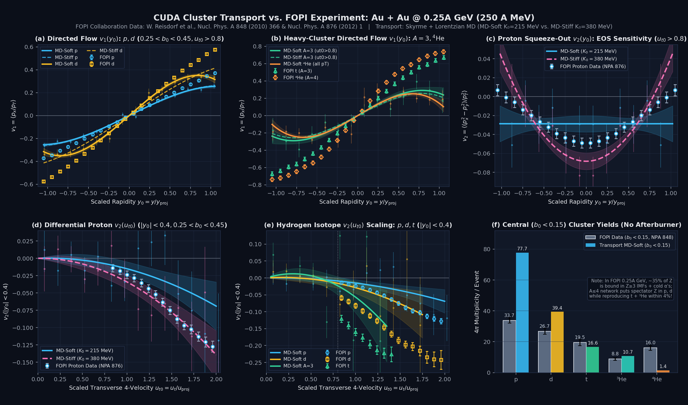
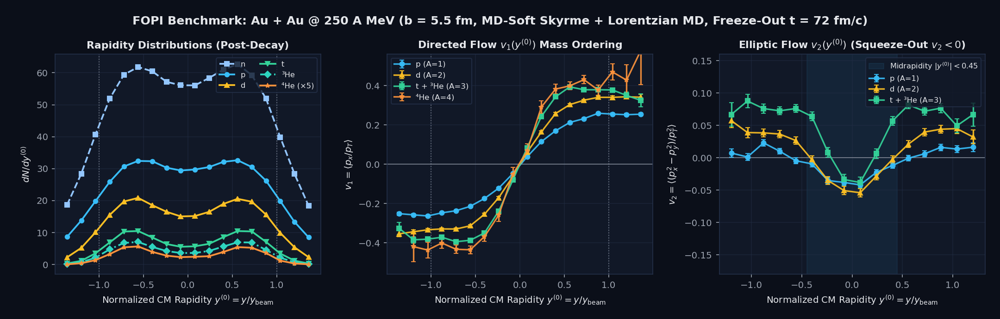
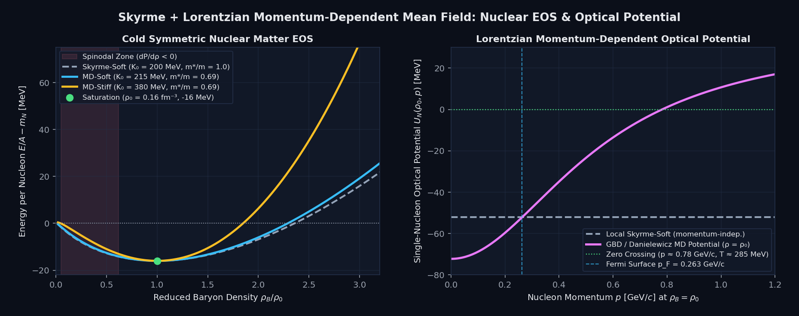
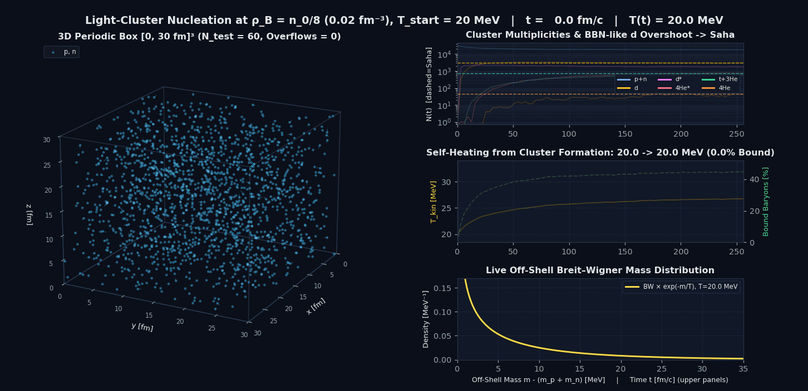
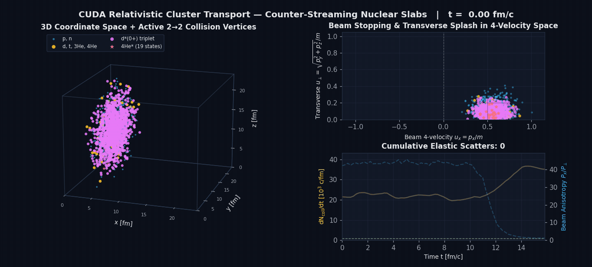
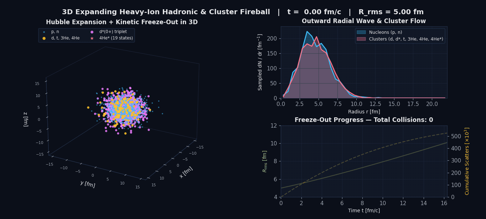

# CUDA Relativistic Nucleon & Light-Cluster Transport

[](#verification-suite)
[](#build--quickstart)
[](LICENSE)

A GPU-native relativistic Vlasov–Boltzmann (BUU) transport code written in **CUDA C++17** for **protons, neutrons, and light nuclear clusters ($A \le 4$) including their discrete excited states** ($d^*$ spin-singlet isospin triplet and 19 excited $A=4$ states ${}^4\text{He}^*$, ${}^4\text{H}^*$, ${}^4\text{Li}^*$), featuring **Skyrme + Lorentzian momentum-dependent mean-field potentials (GBD / Danielewicz), heavy-ion collision initialization & FOPI anisotropic flow observables ($v_1, v_2, dN/dy$), binary 3D local energy & baryon density grid output (`CHYD`), off-shell Breit–Wigner spectral functions, $2 \leftrightarrow 1$ resonance formation/decay, 46 reversible $2 \leftrightarrow 2$ inelastic nuclear channels, and Glauber elastic scattering**.

When `nvcc` is present, all symplectic Vlasov CIC density/force kernels, 3D Gaussian smearing, dynamic slot compaction, multi-level prefix-sum cell sorting, counter-based Philox RNG, and stochastic reaction/decay kernels execute natively on the GPU. On machines without `nvcc` (such as macOS laptops or CI runners), CMake seamlessly compiles the exact same physics kernels via a zero-dependency C++17 host backend.

---

## Visual Demonstrations

### 1. FOPI Heavy-Ion Benchmark: $\text{Au} + \text{Au}$ @ $250\,A\;\text{MeV}$ (`--mode hic`, `--dump-hydro-dir`)
Semi-central ${}^{197}\text{Au} + {}^{197}\text{Au}$ collision at $E_{\text{lab}} = 250\,A\;\text{MeV}$ ($b = 5.5\;\text{fm}$, equal-velocity CM rapidity $y_{\text{beam}} = \pm 0.3572$, `MD-Soft` Skyrme + Lorentzian momentum-dependent potential). Two Woods–Saxon + local Thomas–Fermi nuclei compress to $\max(n_B / \rho_0) \approx 1.80$ with local excitation energy density $\varepsilon_{\text{LRF}} - m_N n_B \approx 60\;\text{MeV}/\text{fm}^3$, exhibiting in-plane spectator bounce-off ($v_1$), midrapidity out-of-plane squeeze-out ($v_2 < 0$), and abundant light-cluster production ($d, t, {}^3\text{He}, {}^4\text{He}$):

<p align="center">
  
</p>

Direct benchmark against published **FOPI Collaboration experimental data** (W. Reisdorf *et al.*, *Nucl. Phys. A* **848** (2010) 366 & *Nucl. Phys. A* **876** (2012) 1) comparing `MD-Soft` ($K_0 = 215\;\text{MeV}$) vs. `MD-Stiff` ($K_0 = 380\;\text{MeV}$) under identical FOPI centrality ($0.25 < b_0 < 0.45$ and $b_0 < 0.15$) and scaled transverse 4-velocity ($u_{t0} > 0.8$) cuts:

<p align="center">
  
</p>

<p align="center">
  
</p>

### 2. Spinodal Liquid–Gas Phase Separation & Cluster Droplets (`--eos md-soft` vs `--eos none`)
Inside the sub-saturation nuclear spinodal zone ($\rho_B \approx 0.27\,\rho_0$, $T_0 = 6\;\text{MeV}$), a free cascade stays spatially uniform whereas the **Skyrme + Lorentzian Momentum-Dependent mean field** ($K_0 = 215\;\text{MeV}$, $m^*(p_F)/m = 0.69$) spontaneously amplifies Poisson density fluctuations into self-bound liquid nuclear droplets enriched with $d, t, {}^3\text{He}, {}^4\text{He}$, and ${}^4\text{He}^*$:

<p align="center">
  
</p>

### 2. Nuclear Matter EOS & Momentum-Dependent Optical Potential (`--dump-eos`)
Exact saturation ($\rho_0 = 0.16\;\text{fm}^{-3}$, $E/A = -16.0\;\text{MeV}$, $P(\rho_0)=0$) across `Skyrme-Soft` ($K_0=200$), `MD-Soft` ($K_0=215$), and `MD-Stiff` ($K_0=380\;\text{MeV}$), alongside the single-nucleon optical potential $U_N(\rho_0, p)$ ($U(0) = -72.2\;\text{MeV}$, crossing zero at $p \approx 0.78\;\text{GeV}/c$ / $T_{\text{kin}} \approx 285\;\text{MeV}$):

<p align="center">
  
</p>

### 3. Sub-Saturation Cluster Nucleation at $\rho_B = n_0 / 8$, $T_{\text{start}} = 20\;\text{MeV}$
Starting from **100% pure protons and neutrons** at nuclear sub-saturation density $\rho_B = n_0 / 8 = 0.02\;\text{fm}^{-3}$ ($L = 30\;\text{fm}, N_{\text{test}} = 60$, zero probability overflows) and $T_{\text{start}} = 20.0\;\text{MeV}$, nearly **45% of all baryons** assemble into bound and resonant clusters ($d, d^*, t, {}^3\text{He}, {}^4\text{He}, {}^4\text{He}^*$)—exhibiting a BBN-like transient deuteron overshoot before converging onto the dashed analytical Saha / SHM equilibrium targets while self-heating the isolated box via cluster formation:

<p align="center">
  
</p>

### 2. High-Density Nucleosynthesis & Off-Shell Breit–Wigner Spectrum (`--mode nucleosynthesis`)
Starting from **100% pure protons and neutrons ($N_{\text{clusters}}(0) = 0$)** in a dense periodic box ($T_0 = 62\;\text{MeV}$), the coupled $2 \leftrightarrow 1$ and $2 \leftrightarrow 2$ network synthesizes the $A \le 4$ hierarchy while populating the thermal-folded Breit–Wigner spectral distribution:

<p align="center">
  
</p>

### 2. Relativistic Breit–Wigner Spectral Functions & Threshold Widths (`--dump-bw`)
Unit-normalized spectral functions $\mathcal{A}_R(m)$ and Blatt–Weisskopf momentum-dependent widths $\Gamma_{\text{tot}}(m) \propto q^{2L+1}$ across $s$-, $p$-, and $d$-wave resonances (`include/physics/resonances.cuh`):

<p align="center">
  
</p>

### 3. Counter-Streaming Nuclear & Excited-Cluster Slabs (`--mode slabs`)
Two opposing beams ($\beta_z = \pm 0.48c$) composed of nucleons ($p, n$), ground-state clusters ($d, t, {}^3\text{He}, {}^4\text{He}$), singlet dinucleons ($d^*$), and excited ${}^4\text{He}^*$ states collide head-on inside a 3D box. Bright yellow-white flashes mark active $2 \to 2$ elastic collision vertices in each step as longitudinal beam momentum splashes into transverse $4\pi$ thermal motion:

<p align="center">
  
</p>

### 2. 3D Expanding Heavy-Ion Hadronic & Cluster Fireball (`--mode fireball`)
A hot baryon-rich fireball ($R_{\text{rms}}(0) = 5\;\text{fm}$) initialized with radial Hubble flow and Maxwell–Jüttner local thermal motion expands into open vacuum, undergoing intense core elastic rescattering followed by kinetic freeze-out:

<p align="center">
  
</p>

### 3. Relativistic Boltzmann Pressure Isotropization (`--mode aniso`)
In a 3D periodic torus $[0, L)^3$, an initially momentum-anisotropic multi-species plasma ($P_z / P_\perp > 3$) relaxes exponentially to the isotropic Maxwell–Jüttner equilibrium circle while conserving total $P^\mu = (E, \vec{P})$ to IEEE-754 double precision ($|\Delta E|/E \sim 10^{-15}$) and $\Delta B = \Delta Q = 0$:

<p align="center">
  
</p>

---

## Physics Model

### Complete 28-Species Catalog ($A \le 4$, Ground + Excited)
Defined in [`include/physics/species.cuh`](include/physics/species.cuh):

| Family | Species | $A$ | $Z$ | $J^\pi$ | $I$ | Notes |
| :--- | :--- | :---: | :---: | :---: | :---: | :--- |
| **Nucleons** | $p,\; n$ | 1 | 1, 0 | $1/2^+$ | $1/2$ | AME2020 / CODATA masses |
| **Dinucleons** | $d$ | 2 | 1 | $1^+$ | $0$ | Ground-state deuteron ($R_{\text{rms}} = 2.14\;\text{fm}$) |
| **Excited $A=2$** | $nn^*(0^+),\; d^*(0^+),\; pp^*(0^+)$ | 2 | 0, 1, 2 | $0^+$ | $1$ | Spin-singlet virtual/resonant isospin triplet ($R_{\text{rms}} = 3.80\;\text{fm}$) |
| **Trinucleons** | $t,\; {}^3\text{He}$ | 3 | 1, 2 | $1/2^+$ | $1/2$ | Ground-state $A=3$ mirror doublet |
| **Alpha (g.s.)** | ${}^4\text{He}$ | 4 | 2 | $0^+$ | $0$ | Compact ground state ($R_{\text{rms}} = 1.68\;\text{fm}$) |
| **Excited ${}^4\text{He}^*$** | 17 discrete TUNL levels | 4 | 2 | $0^\pm, 1^\pm, 2^\pm$ | $0, 1$ | $E_x = 20.21\;\text{MeV}$ ($0^+$ breathing mode) to $29.89\;\text{MeV}$ ($2^+$) |
| **Isobaric $A=4^*$** | ${}^4\text{H}^*(2^-),\; {}^4\text{Li}^*(2^-)$ | 4 | 1, 3 | $2^-$ | $1$ | $I=1$ resonant partners above $t+n$ and ${}^3\text{He}+p$ |

### Cancellation-Free Relativistic Kinematics
In [`include/physics/kinematics.cuh`](include/physics/kinematics.cuh), invariant pair quantities are evaluated via the algebraic identity

$$Q^2 \equiv (p_1 \cdot p_2)^2 - m_1^2 m_2^2 = |E_2 \vec{p}_1 - E_1 \vec{p}_2|^2 - |\vec{p}_1 \times \vec{p}_2|^2$$

eliminating catastrophic floating-point cancellation near threshold $s \to (m_1 + m_2)^2$ even when $\sim 3.75\;\text{GeV}$ excited $A=4$ clusters collide at keV relative kinetic energies under large Lorentz boosts.

### Elastic Cross Sections & Excited-State Spatial Swelling
Implemented in [`include/physics/cross_sections.cuh`](include/physics/cross_sections.cuh):
- **Elementary $NN$ ($pp, nn, np$)**: Smoothly bridges low-energy $S$-wave Effective Range Expansion (ERE), nuclear-regime Kikuchi–Kawai / Metropolis parameterizations, and high-energy Cugnon / PDG elastic fits.
- **Nucleon–Cluster & Cluster–Cluster**: Evaluates isospin-weighted $\bar{\sigma}_{NN}(\gamma_{\text{rel}})$ at the Lorentz-invariant relative factor $\gamma_{\text{rel}} = (p_1 \cdot p_2)/(m_1 m_2)$ and combines matter radii via the analytic Gaussian Glauber / Karol optical eikonal overlap:

$$\sigma_{AB}^{\text{el}}(\gamma_{\text{rel}}) = \pi a_{AB}^2 \ln\!\left(1 + \frac{A B \, \bar{\sigma}_{NN}(\gamma_{\text{rel}})}{\pi a_{AB}^2}\right), \qquad a_{AB}^2 = \frac{2}{3}\left(R_A^2 + R_B^2\right)$$

Diffuse excited states such as $d^*(0^+)$ and the ${}^4\text{He}^*(20.21, 0^+)$ monopole breathing mode naturally exhibit enhanced elastic cross sections relative to their compact ground states:

<p align="center">
  
</p>

---

## GPU Architecture & Repository Layout

```text
├── CMakeLists.txt                  # Auto-detects CUDA nvcc (SM 70–90) or C++17 host fallback
├── include/
│   ├── backend/
│   │   ├── cuda_compat.cuh         # DeviceBuffer<T>, atomic wrappers, CUDA/CPU portability macros
│   │   └── philox_rng.cuh          # Stateless counter-based Philox4x32-10 PRNG (zero VRAM state)
│   ├── physics/
│   │   ├── constants.cuh           # Physical constants & AME2020 nuclear masses (GeV, fm)
│   │   ├── species.cuh             # 28-species nucleon + cluster + excited-state table
│   │   ├── kinematics.cuh          # Cancellation-free Moller flux, CM boosts, 2->2 & 1->2 decays
│   │   ├── cross_sections.cuh      # ERE+KK+Cugnon NN & Gaussian Glauber cluster cross sections
│   │   ├── resonances.cuh          # Relativistic Breit-Wigner spectral functions & BW samplers
│   │   ├── inelastic_channels.cuh  # 46 reversible 2<->2 transfer, catalysis & excitation rules
│   │   └── mean_field.cuh          # Skyrme + Lorentzian MD potential, CIC Vlasov & smoothing
│   └── sim/
│       ├── particles.cuh           # Dynamic SoA layout with GPU atomic appends & compaction
│       ├── grid.cuh                # GPU multi-level prefix sum + counting-sort 3D cell builder
│       ├── stepper.cuh             # Symplectic Strang-split Vlasov + decay + stochastic collisions
│       ├── init_conditions.cuh     # Woods-Saxon + Thomas-Fermi HIC, grand-canonical & fireball
│       ├── hydro_io.cuh            # Binary 3D local energy & baryon density grid writer ("CHYD")
│       ├── flow_observables.cuh    # Freeze-out resonance decay & FOPI dN/dy, v1, v2 calculator
│       └── observables.cuh         # Parallel GPU reductions for P^mu, B, Q, T^ij & mass moments
├── src/
│   ├── main.cu                     # CLI simulation driver, CSV logger & binary CHYD/CTR2 exporters
│   └── tests.cu                    # Automated physics, Vlasov, HIC & detailed-balance suite
├── scripts/
│   ├── generate_auau_fopi_plots.py # FOPI Au+Au 250 AMeV 3D+hydro animation & v1/v2/dNdy plots
│   ├── generate_meanfield_animations.py
│   ├── generate_inelastic_animations.py
│   └── generate_animations.py      # Reproduces all GIF/MP4 animations and physics figures
└── assets/                         # Rendered animations and spectral/cross-section plots
```

### Binary 3D Local Energy & Baryon Density Format (`CHYD`)
Passing `--dump-hydro-dir <dir> --dump-hydro-every <N>` writes self-describing binary 3D grid files `hydro_grid_XXXX.bin` (`include/sim/hydro_io.cuh`):
- **88-byte header (`HydroGridHeader`)**: `uint32 magic = 0x44594843 ("CHYD")`, `int32 version, step, nx, ny, nz, n_fields=8, reserved`, `float64 t_fm, xmin, xmax, ymin, ymax, zmin, zmax`.
- **8 contiguous `float32` 3D arrays** of shape `(nz, ny, nx)`: `[0] rho_B_lab` ($\text{fm}^{-3}$), `[1] rho_B_lrf` (comoving proper $n_B = \sqrt{(J^0)^2 - |\vec{J}|^2}$), `[2] rho_Q_lab`, `[3] e_tot_lab` ($T^{00}_{\text{kin}} + \mathcal{V}_{\text{Skyrme+MD}}$ in $\text{GeV}/\text{fm}^3$), `[4] eps_lrf` (local rest-frame energy density $\varepsilon_{\text{LRF}}$ in $\text{GeV}/\text{fm}^3$), `[5..7] vx, vy, vz` ($c$).

### Stochastic Collision Kernel (`DisjointPairs` vs `AllPairs`)
Inside each spatial cell of volume $\Delta V$ containing $N_c$ test particles (oversampling factor $N_{\text{test}}$):
- **`DisjointPairs` (default, $O(N_p)$ lock-free GPU parallel)**: 1 CUDA thread block per cell performs an in-cache Fisher–Yates shuffle and evaluates all $M_c = \lfloor N_c / 2 \rfloor$ disjoint pairs $(2k, 2k+1)$ simultaneously across threads with exact odd/even pair-multiplicity weighting:
  $$P_{\text{pair}} = \frac{N_c(N_c - 1)/2}{\lfloor N_c / 2 \rfloor} \, \frac{v_{\text{Møller}} \, \sigma_{\text{el}}(\sqrt{s}) \, \Delta t}{N_{\text{test}} \, \Delta V}$$
- **`AllPairs`**: Traverses all $N_c(N_c-1)/2$ intra-cell pairs in randomized order with single-scatter-per-substep guards.

---

## Build & Quickstart

### 1. Build (CUDA GPU or CPU Host Fallback)
```bash
cmake -S . -B build -DCMAKE_BUILD_TYPE=Release
cmake --build build -j
```
On a CUDA workstation/cluster, CMake automatically invokes `nvcc` (pass `-DCMAKE_CUDA_ARCHITECTURES=native` to target your exact GPU).

### 2. Run Verification Suite (`ctest`)
```bash
ctest --test-dir build --output-on-failure -V
```

### 3. Run Simulations
```bash
# Print all 28 species (ground & excited), thresholds, spectral norms, and cross sections
./build/cluster_transport --print-species

# Dynamic nucleosynthesis of d, d*, t, 3He, 4He, and 4He* from pure p + n
./build/cluster_transport --mode nucleosynthesis --npart 30000 --ntest 15 --steps 80 --dt 0.15

# FOPI Au + Au @ 250 A MeV (b = 5.5 fm) with binary 3D hydro dumps every 1.5 fm/c & flow CSV
./build/cluster_transport --mode hic --A-nuc 197 --Z-nuc 79 --elab-amev 250.0 --impact-b 5.5 \
  --eos md-soft --ntest 120 --box 48.0 --grid 24 --steps 240 --dt 0.30 \
  --dump-hydro-dir output/auau250_hydro --dump-hydro-every 5 --flow-csv output/fopi_auau250_flow.csv

# Spinodal clumping + cluster nucleation with MD-Soft Skyrme + Momentum-Dependent potential
./build/cluster_transport --mode nucleosynthesis --eos md-soft --npart 30000 --ntest 30 --temp 8.0 --steps 250 --dt 0.40

# Compare Soft (K0 = 215 MeV) vs Stiff (K0 = 380 MeV) MD-Skyrme in expanding fireball
./build/cluster_transport --mode fireball --eos md-stiff --reactions all --npart 100000 --ntest 25 --steps 80 --dt 0.25
```

### 4. Regenerate Animations & Figures
Requires `python3` (`numpy`, `matplotlib`) and `ffmpeg`:
```bash
python3 scripts/generate_auau_fopi_plots.py
python3 scripts/generate_meanfield_animations.py
python3 scripts/generate_n0_over_8_nucleation.py
python3 scripts/generate_inelastic_animations.py
python3 scripts/generate_animations.py
```

---

## Verification Suite

[`src/tests.cu`](src/tests.cu) validates all physics and numerical invariants on every build:
1. **`test_species_table`**: Quantum numbers ($B, Z, J^\pi, I, g=2J+1$), pole masses, widths, and radii across all 6 ground and 22 excited states.
2. **`test_relativistic_kinematics`**: Boosted sub-keV threshold elastic, exothermic $2 \to 2$ ($d+t \to n+{}^4\text{He}$), and $1 \to 2$ resonance decay kinematics conserving $P^\mu$ to $< 10^{-13}$.
3. **`test_cross_section_hierarchy`**: Verifies $\sigma_{pn} > \sigma_{pp}$, $\sigma_{p d^*} > \sigma_{p d}$, and $\sigma_{p\,{}^4\text{He}^*(20.21)} > \sigma_{p\,{}^4\text{He}}$.
4. **`test_breit_wigner_spectral_properties`**: Verifies unit spectral normalization $\int \mathcal{A}_R(m)\,dm = 1$, exact threshold vanishing $\Gamma(m \le m_{\text{th}}) = 0$, and $(B, Q)$ conservation across all 22 resonances and 46 inelastic $2 \leftrightarrow 2$ channels.
5. **`test_stochastic_boltzmann_rate`**: Benchmarks both `DisjointPairs` and `AllPairs` at odd cell occupancy ($N_c = 251$) against the exact analytical pair sum.
6. **`test_detailed_balance_2to1_resonances`**: Verifies microscopic $2 \leftrightarrow 1$ detailed balance ($p+n \leftrightarrow d^*$: formations match decays within $<1\%$) and stationary off-shell $\langle m_{d^*} \rangle$ in a grand-canonical box.
7. **`test_detailed_balance_full_chemical_network`**: Verifies chemical stationarity across all 28 species with all $2 \leftrightarrow 1$ and 46 $2 \leftrightarrow 2$ reactions simultaneously active.
8. **`test_dynamic_cluster_nucleosynthesis`**: Verifies spontaneous nucleation of $d, d^*, t, {}^3\text{He}, {}^4\text{He}$, and ${}^4\text{He}^*$ from pure $p+n$ with $|\Delta E|/E \sim 10^{-15}$.
9. **`test_reactive_expanding_fireball`**: Radial Hubble expansion with coupled elastic, inelastic, and resonance decay dynamics.
10. **`test_eos_saturation_and_md`**: Verifies exact cold-matter saturation ($E/A(\rho_0) = -16.00\;\text{MeV}$, $P(\rho_0)=0$, $K_0 = 200/215/380\;\text{MeV}$), optical-potential zero crossing ($U(0)=-72.2\;\text{MeV} \to U(1\;\text{GeV}/c)=+10.7\;\text{MeV}$), and Landau effective mass $m^*(p_F)/m = 0.692$.
11. **`test_vlasov_and_spinodal`**: Verifies symplectic Velocity-Verlet Hamiltonian conservation ($|\Delta H|/H < 10^{-3}$), exact CIC lattice momentum conservation ($|\Delta\vec{P}| \sim 10^{-13}\;\text{GeV}/c$), and spinodal density-contrast amplification.
12. **`test_hic_and_hydro_binary_output`**: Verifies Woods–Saxon + Thomas–Fermi $\text{Au}+\text{Au}$ CM initialization ($|\vec{P}_{\text{tot}}| < 10^{-11}\;\text{GeV}/c$) and binary `CHYD` 3D density grid conservation ($\int \rho_{B,\text{lab}}\,dV = 2 A_{\text{nuc}}$).

## Roadmap
- [x] Covariant $2 \to 2$ elastic scattering for $p, n, d, d^*, t, {}^3\text{He}, {}^4\text{He}$, and 19 excited $A=4^*$ states on CUDA
- [x] Relativistic Breit–Wigner spectral functions and $2 \leftrightarrow 1$ resonance formation/decay ($d^* \leftrightarrow N+N$, ${}^4\text{He}^* \leftrightarrow p+t / n+{}^3\text{He} / d+d$, ${}^4\text{H}^* \leftrightarrow n+t$, ${}^4\text{Li}^* \leftrightarrow p+{}^3\text{He}$)
- [x] Reversible $2 \leftrightarrow 2$ nuclear transfer ($dd \leftrightarrow pt/n\,{}^3\text{He}$, $dt \leftrightarrow n\alpha$, $d\,{}^3\text{He} \leftrightarrow p\alpha$), deuteron catalysis ($N+d \leftrightarrow N+d^*$), and ${}^4\text{He} \leftrightarrow {}^4\text{He}^*$ excitation with off-shell detailed balance
- [x] Skyrme + Lorentzian momentum-dependent mean-field potential (`SkyrmeSoft`, `MDSoft`, `MDStiff`) with baryon/isospin-additive cluster folding and symplectic CIC Vlasov kernels
- [x] Heavy-ion collision initialization (`--mode hic`), FOPI flow observables ($v_1, v_2, dN/dy$), and binary 3D local energy & baryon density grid output (`CHYD`)
- [ ] GPU 6D phase-space Pauli blocking $(1 - f_3)(1 - f_4)$ & Bose enhancement + direct $2 \leftrightarrow 3$ channels
