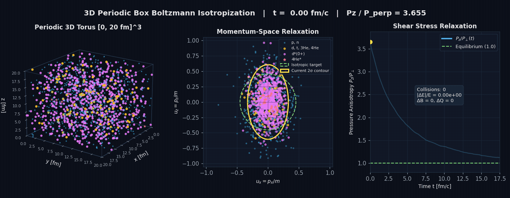
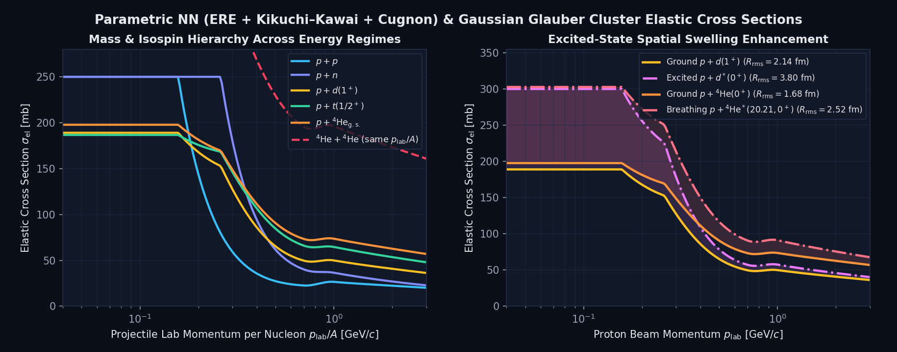

# CUDA Relativistic Nucleon & Light-Cluster Transport

[](#verification-suite)
[](#build--quickstart)
[](LICENSE)

A GPU-native relativistic Boltzmann transport code written in **CUDA C++17** for **protons, neutrons, and light nuclear clusters ($A \le 4$) including their discrete excited states** ($d^*$ spin-singlet isospin triplet and 19 excited $A=4$ states ${}^4\text{He}^*$, ${}^4\text{H}^*$, ${}^4\text{Li}^*$), starting with **covariant elastic $2 \to 2$ scattering**.

When `nvcc` is present, all particle propagation, 3D spatial grid binning, multi-level prefix-sum cell sorting, counter-based Philox RNG, and stochastic binary collision kernels execute natively on the GPU. On machines without `nvcc` (such as macOS laptops or CI runners), CMake seamlessly compiles the exact same physics kernels via a zero-dependency C++17 host backend.

---

## Visual Demonstrations

### 1. Counter-Streaming Nuclear & Excited-Cluster Slabs (`--mode slabs`)
Two opposing beams ($\beta_z = \pm 0.48c$) composed of nucleons ($p, n$), ground-state clusters ($d, t, {}^3\text{He}, {}^4\text{He}$), singlet dinucleons ($d^*$), and excited ${}^4\text{He}^*$ states collide head-on inside a 3D box. Bright yellow-white flashes mark active $2 \to 2$ elastic collision vertices in each step as longitudinal beam momentum splashes into transverse $4\pi$ thermal motion:

<p align="center">
  
</p>

### 2. 3D Expanding Heavy-Ion Hadronic & Cluster Fireball (`--mode fireball`)
A hot baryon-rich fireball ($R_{\text{rms}}(0) = 5\;\text{fm}$) initialized with radial Hubble flow and Maxwell–Jüttner local thermal motion expands into open vacuum, undergoing intense core elastic rescattering followed by kinetic freeze-out:

<p align="center">
  
</p>

### 3. Relativistic Boltzmann Pressure Isotropization (`--mode aniso`)
In a 3D periodic torus $[0, L)^3$, an initially momentum-anisotropic multi-species plasma ($P_z / P_\perp > 3$) relaxes exponentially to the isotropic Maxwell–Jüttner equilibrium circle while conserving total $P^\mu = (E, \vec{P})$ to IEEE-754 double precision ($|\Delta E|/E \sim 10^{-15}$) and $\Delta B = \Delta Q = 0$:

<p align="center">
  
</p>

---

## Physics Model

### Complete 28-Species Catalog ($A \le 4$, Ground + Excited)
Defined in [`include/physics/species.cuh`](include/physics/species.cuh):

| Family | Species | $A$ | $Z$ | $J^\pi$ | $I$ | Notes |
| :--- | :--- | :---: | :---: | :---: | :---: | :--- |
| **Nucleons** | $p,\; n$ | 1 | 1, 0 | $1/2^+$ | $1/2$ | AME2020 / CODATA masses |
| **Dinucleons** | $d$ | 2 | 1 | $1^+$ | $0$ | Ground-state deuteron ($R_{\text{rms}} = 2.14\;\text{fm}$) |
| **Excited $A=2$** | $nn^*(0^+),\; d^*(0^+),\; pp^*(0^+)$ | 2 | 0, 1, 2 | $0^+$ | $1$ | Spin-singlet virtual/resonant isospin triplet ($R_{\text{rms}} = 3.80\;\text{fm}$) |
| **Trinucleons** | $t,\; {}^3\text{He}$ | 3 | 1, 2 | $1/2^+$ | $1/2$ | Ground-state $A=3$ mirror doublet |
| **Alpha (g.s.)** | ${}^4\text{He}$ | 4 | 2 | $0^+$ | $0$ | Compact ground state ($R_{\text{rms}} = 1.68\;\text{fm}$) |
| **Excited ${}^4\text{He}^*$** | 17 discrete TUNL levels | 4 | 2 | $0^\pm, 1^\pm, 2^\pm$ | $0, 1$ | $E_x = 20.21\;\text{MeV}$ ($0^+$ breathing mode) to $29.89\;\text{MeV}$ ($2^+$) |
| **Isobaric $A=4^*$** | ${}^4\text{H}^*(2^-),\; {}^4\text{Li}^*(2^-)$ | 4 | 1, 3 | $2^-$ | $1$ | $I=1$ resonant partners above $t+n$ and ${}^3\text{He}+p$ |

### Cancellation-Free Relativistic Kinematics
In [`include/physics/kinematics.cuh`](include/physics/kinematics.cuh), invariant pair quantities are evaluated via the algebraic identity

$$Q^2 \equiv (p_1 \cdot p_2)^2 - m_1^2 m_2^2 = |E_2 \vec{p}_1 - E_1 \vec{p}_2|^2 - |\vec{p}_1 \times \vec{p}_2|^2$$

eliminating catastrophic floating-point cancellation near threshold $s \to (m_1 + m_2)^2$ even when $\sim 3.75\;\text{GeV}$ excited $A=4$ clusters collide at keV relative kinetic energies under large Lorentz boosts.

### Elastic Cross Sections & Excited-State Spatial Swelling
Implemented in [`include/physics/cross_sections.cuh`](include/physics/cross_sections.cuh):
- **Elementary $NN$ ($pp, nn, np$)**: Smoothly bridges low-energy $S$-wave Effective Range Expansion (ERE), nuclear-regime Kikuchi–Kawai / Metropolis parameterizations, and high-energy Cugnon / PDG elastic fits.
- **Nucleon–Cluster & Cluster–Cluster**: Evaluates isospin-weighted $\bar{\sigma}_{NN}(\gamma_{\text{rel}})$ at the Lorentz-invariant relative factor $\gamma_{\text{rel}} = (p_1 \cdot p_2)/(m_1 m_2)$ and combines matter radii via the analytic Gaussian Glauber / Karol optical eikonal overlap:

$$\sigma_{AB}^{\text{el}}(\gamma_{\text{rel}}) = \pi a_{AB}^2 \ln\!\left(1 + \frac{A B \, \bar{\sigma}_{NN}(\gamma_{\text{rel}})}{\pi a_{AB}^2}\right), \qquad a_{AB}^2 = \frac{2}{3}\left(R_A^2 + R_B^2\right)$$

Diffuse excited states such as $d^*(0^+)$ and the ${}^4\text{He}^*(20.21, 0^+)$ monopole breathing mode naturally exhibit enhanced elastic cross sections relative to their compact ground states:

<p align="center">
  
</p>

---

## GPU Architecture & Repository Layout

```text
├── CMakeLists.txt                  # Auto-detects CUDA nvcc (SM 70–90) or C++17 host fallback
├── include/
│   ├── backend/
│   │   ├── cuda_compat.cuh         # DeviceBuffer<T>, atomic wrappers, CUDA/CPU portability macros
│   │   └── philox_rng.cuh          # Stateless counter-based Philox4x32-10 PRNG (zero VRAM state)
│   ├── physics/
│   │   ├── constants.cuh           # Physical constants & AME2020 nuclear masses (GeV, fm)
│   │   ├── species.cuh             # 28-species nucleon + cluster + excited-state table
│   │   ├── kinematics.cuh          # Cancellation-free Moller flux, CM boosts & 2->2 scattering
│   │   └── cross_sections.cuh      # ERE+KK+Cugnon NN & Gaussian Glauber cluster cross sections
│   └── sim/
│       ├── particles.cuh           # Coalesced Structure-of-Arrays (ParticleSoAView) GPU layout
│       ├── grid.cuh                # GPU multi-level prefix sum + counting-sort 3D cell builder
│       ├── stepper.cuh             # Strang-split drift + DisjointPairs / AllPairs CUDA kernels
│       ├── init_conditions.cuh     # 4-Gamma Maxwell-Juttner sampler, box, slabs & fireball init
│       └── observables.cuh         # Parallel GPU reductions for P^mu, B, Q, T^ij & species yields
├── src/
│   ├── main.cu                     # CLI simulation driver, CSV logger & binary frame exporter
│   └── tests.cu                    # 6-part automated physics & stochastic rate verification suite
├── scripts/
│   └── generate_animations.py      # Reproduces all GIF/MP4 animations and cross-section figures
└── assets/                         # Rendered animations and cross-section plots
```

### Stochastic Collision Kernel (`DisjointPairs` vs `AllPairs`)
Inside each spatial cell of volume $\Delta V$ containing $N_c$ test particles (oversampling factor $N_{\text{test}}$):
- **`DisjointPairs` (default, $O(N_p)$ lock-free GPU parallel)**: 1 CUDA thread block per cell performs an in-cache Fisher–Yates shuffle and evaluates all $M_c = \lfloor N_c / 2 \rfloor$ disjoint pairs $(2k, 2k+1)$ simultaneously across threads with exact odd/even pair-multiplicity weighting:
  $$P_{\text{pair}} = \frac{N_c(N_c - 1)/2}{\lfloor N_c / 2 \rfloor} \, \frac{v_{\text{Møller}} \, \sigma_{\text{el}}(\sqrt{s}) \, \Delta t}{N_{\text{test}} \, \Delta V}$$
- **`AllPairs`**: Traverses all $N_c(N_c-1)/2$ intra-cell pairs in randomized order with single-scatter-per-substep guards.

---

## Build & Quickstart

### 1. Build (CUDA GPU or CPU Host Fallback)
```bash
cmake -S . -B build -DCMAKE_BUILD_TYPE=Release
cmake --build build -j
```
On a CUDA workstation/cluster, CMake automatically invokes `nvcc` (pass `-DCMAKE_CUDA_ARCHITECTURES=native` to target your exact GPU).

### 2. Run Verification Suite (`ctest`)
```bash
ctest --test-dir build --output-on-failure -V
```

### 3. Run Simulations
```bash
# Print all 28 species (ground & excited) and sample p + X elastic cross sections
./build/cluster_transport --print-species

# Counter-streaming nuclear & excited-cluster slabs
./build/cluster_transport --mode slabs --npart 50000 --ntest 10 --steps 80 --dt 0.20

# Anisotropic 3D periodic box relaxation
./build/cluster_transport --mode aniso --npart 100000 --ntest 25 --steps 100 --dt 0.20

# 3D radially expanding heavy-ion fireball
./build/cluster_transport --mode fireball --npart 100000 --ntest 25 --steps 80 --dt 0.25
```

### 4. Regenerate Animations & Figures
Requires `python3` (`numpy`, `matplotlib`) and `ffmpeg`:
```bash
python3 scripts/generate_animations.py
```

---

## Verification Suite

[`src/tests.cu`](src/tests.cu) validates six core invariants on every build:
1. **`test_species_table`**: Quantum numbers ($B, Z, J^\pi, I, g=2J+1$), pole masses, widths, and radii across all 6 ground and 22 excited states.
2. **`test_relativistic_kinematics`**: Boosted ($\beta \approx 0.77$) sub-keV threshold ${}^4\text{He}^*(20.21) + d^*(0^+)$ scattering conserving $P^\mu$ and mass-shell to $< 10^{-13}$.
3. **`test_cross_section_hierarchy`**: Verifies $\sigma_{pn} > \sigma_{pp}$, $\sigma_{p d^*} > \sigma_{p d}$, and $\sigma_{p\,{}^4\text{He}^*(20.21)} > \sigma_{p\,{}^4\text{He}}$.
4. **`test_stochastic_boltzmann_rate`**: Benchmarks both `DisjointPairs` and `AllPairs` at odd cell occupancy ($N_c = 251$) against the exact analytical pair sum $\sum_{i<j} v_{\text{Møller}} \sigma_0 \Delta t / (N_{\text{test}} V)$.
5. **`test_multispecies_isotropization`**: Multi-species shear relaxation $P_z/P_\perp: 3.96 \to 1.03$ with $|\Delta E|/E \sim 10^{-15}$.
6. **`test_open_expanding_fireball`**: Radial Hubble expansion and vacuum boundary free-streaming with exact conservation laws.

## Roadmap
- [x] Covariant $2 \to 2$ elastic scattering for $p, n, d, d^*, t, {}^3\text{He}, {}^4\text{He}$, and 19 excited $A=4^*$ states on CUDA
- [ ] Breit–Wigner spectral functions and finite-lifetime resonance formation/decay ($d^* \leftrightarrow p + n$, ${}^4\text{He}^* \leftrightarrow p+t / n+{}^3\text{He} / d+d$)
- [ ] Inelastic excitation / de-excitation channels ($N + {}^4\text{He} \leftrightarrow N + {}^4\text{He}^*$) with detailed balance
- [ ] Pion/nucleon-catalyzed $2 \leftrightarrow 3$ cluster reactions ($N + N + N \leftrightarrow N + d$, $\pi + d \leftrightarrow \pi + p + n$)
